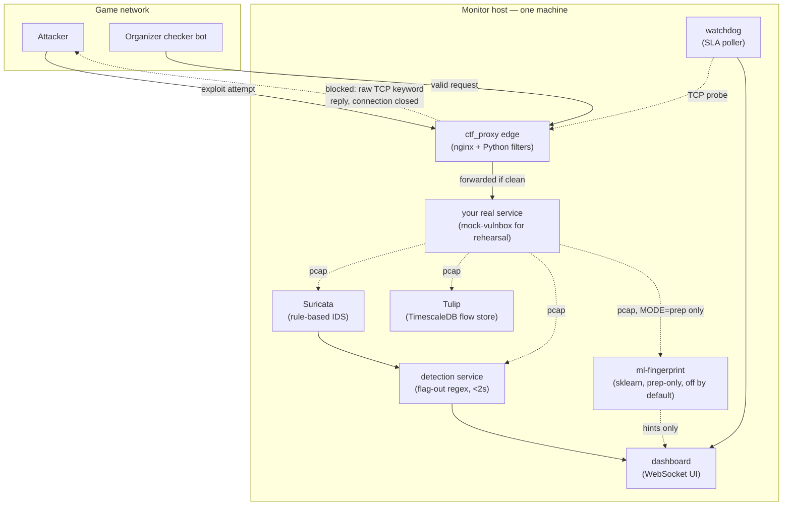

<div align="center">

# 🛡️ CTF Monitor Hub

**Single-machine situational-awareness stack for Attack-Defense CTF competitions.**

Edge mitigation, deterministic flag-exfiltration detection, and SLA watchdogs — all driven
from one config file. No LLM/generative-AI path exists in this repo (removed — see
`docs/STATUS.md`); the optional `ml-fingerprint` classifier (sklearn, non-generative) is the
only model-adjacent component, and it's off by default.

[](https://www.python.org/)
[](https://docs.docker.com/compose/)

**→ [START.md](START.md) — khởi chạy lần đầu, bắt đầu ở đây.**  
**→ [CONFIG.md](CONFIG.md) — need to change a port/IP/config RIGHT NOW mid-competition? Start there, not here.**

[Architecture](docs/ARCHITECTURE.md) · [Runbook](docs/RUNBOOK.md) · [Config schema](docs/SCHEMA.md) · [Verified status](docs/STATUS.md) · [Demo script](docs/DEMO.md) · [Go live on competition day](docs/GOLIVE.md)

</div>

---

## What this is

In an A/D CTF, every team runs the same vulnerable services on a "vulnbox." Other teams
attack it to steal flags; an organizer checker bot continuously verifies your services are
still up. This repo is the monitoring/defense half of that loop, built to run entirely on
one machine:

- **Block** known attack patterns at the edge before they reach your service.
- **Know immediately** when a flag leaves your network outbound.
- **Get paged** the moment a service — or the edge proxy itself — goes down.

It's a monitoring hub, not a CTF platform: it doesn't run your vulnerable services for you
(a toy `mock-vulnbox` is included only so the whole pipeline can be exercised on a laptop
before competition day).

## Architecture



No LLM / generative-AI path exists anywhere in this repo (removed by explicit decision — see
`docs/STATUS.md`). Two layers do the actual work, plus an optional non-generative hint layer:

1. **Edge mitigation** — [`ctf_proxy`](https://github.com/ByteLeMani/ctf_proxy) (a real
   upstream project, not reinvented) sits in front of your services. Python filter modules
   decide per-request whether to drop traffic; a blocked connection gets a raw
   `KEYWORD SERVICE ATTACK_NAME` reply so it's instantly greppable in a pcap — there's no
   HTTP status line, so don't expect a `403` from `curl`.
2. **Detection & forensics** — [Tulip](https://github.com/OpenAttackDefenseTools/tulip)
   assembles flows into TimescaleDB/Postgres; Suricata does signature-based IDS; a small
   `detection` service regex-scans for your flag format and ingests Suricata alerts, both
   landing on the dashboard in under a second.
3. **Optional bot-deviation hints** (`MODE=prep` only, off by default) — `ml-fingerprint` is
   sklearn DBSCAN clustering over L3/L4 traffic cadence, not a model you train or an LLM — it
   flags connections that look unlike the organizer's checker bot. Hints only, never auto-acts,
   and has no effect at all under `MODE=contest` regardless of its config flag.

## Quick start

```bash
git clone <this-repo>
cd Setup_tool

# Edit vulnbox IP, flag regex, service ports, ctf_proxy keyword, etc.
nano contest-runtime/config/services.json
bash contest-runtime/config/validate-config.sh

# Pull images once (needs internet; ~10-20 min)
bash pull-and-save.sh

# Bring everything up — generates every tool's config from services.json first,
# runs a preflight check (docker/docker-compose/python3/redis), then starts
# only contest-runtime/ (MODE=contest) — nothing prep-only ever starts
MODE=contest bash deploy-all.sh
```

Open the dashboard at `http://localhost:8080`. Full walkthrough, troubleshooting, and the
air-gapped restore path are in [`docs/RUNBOOK.md`](docs/RUNBOOK.md). Need to change something
mid-competition? [`CONFIG.md`](CONFIG.md), not this file.

**Verify the edge-mitigation loop works** (legit traffic passes, an attack gets blocked, SLA
stays green):

```bash
cd offline-bundle/repos/ctf_proxy && python3 harness.py
```

## One config, every tool

`contest-runtime/config/services.json` is the single source of truth.
`contest-runtime/config/generators/*.py` turn it into each tool's native config (`.env` for
Tulip, `config.json` for `ctf_proxy`, ...) — `bringup.sh` always regenerates before starting
anything, so a one-line config change (a port, the vulnbox IP, the `ctf_proxy` keyword)
propagates everywhere with no manual edits. `validate-config.sh` checks required fields and
that `ctf_proxy`'s generated keyword hasn't drifted from `services.json`'s. Full field
reference: [`docs/SCHEMA.md`](docs/SCHEMA.md).

## What's actually verified

Every claim in this README has been run and checked on real traffic, not just coded — see
[`docs/STATUS.md`](docs/STATUS.md) for the evidence log (commands, output, root causes of the
bugs found along the way) and what's still a known rough edge.

## Repo layout

| Path | What it is |
|---|---|
| `contest-runtime/` | Everything allowed to run during the 8h contest (`MODE=contest`) |
| `contest-runtime/config/` | `services.json` (single source of truth) + `validate-config.sh` + `generators/` |
| `contest-runtime/detection/` | Flag-out regex scanner, honeytoken collector, Suricata ruleset |
| `contest-runtime/watchdog/` | SLA health-check poller + OS-watchdog deploy scripts |
| `contest-runtime/monitor/` | Vulnbox traffic-capture deploy scripts |
| `contest-runtime/defense/` | ctf_proxy deploy script + block-rule templates |
| `contest-runtime/dashboard/` | Real-time alert UI (FastAPI + plain JS, no build step) |
| `contest-runtime/hostagent/` + `host_agent.py` | Host-side process that executes Dashboard-requested changes (whitelisted actions only) |
| `prep-only/` | **Never started under `MODE=contest`** — home/practice fixtures only |
| `prep-only/ml-classifier/` | Optional sklearn (DBSCAN) bot-fingerprint hint layer, off by default |
| `prep-only/training/mock-vulnbox/` | Toy vulnerable services for rehearsal before competition day |
| `docker-compose.contest.yml` / `docker-compose.prep.yml` | The only two compose files; `MODE=contest` never touches the second one |
| `bringup.sh` / `teardown.sh` / `deploy-all.sh` | Orchestration — all require `MODE=contest\|prep` |
| `docs/` | Architecture, runbook, config schema, verified status, demo script |

`offline-bundle/` (cloned upstream repos, Docker images) is a build artifact, not source — it's
gitignored; regenerate it with `pull-and-save.sh`.

## Credits

Built on top of, not instead of:
[Tulip](https://github.com/OpenAttackDefenseTools/tulip) ·
[ctf_proxy](https://github.com/ByteLeMani/ctf_proxy) ·
[pcap-broker](https://github.com/fox-it/pcap-broker) ·
[Suricata](https://suricata.io/)
