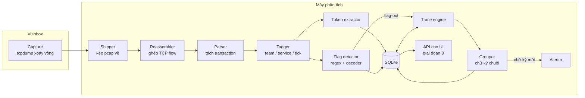
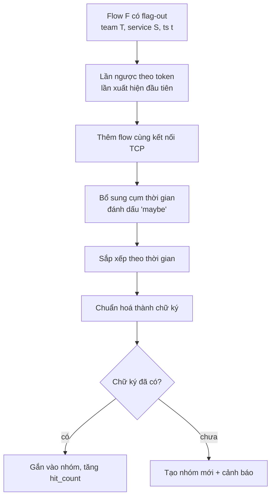

# flagtrace — Kiến trúc (Giai đoạn 1 & 2)

> **Đối chiếu 2026-10-14:** đây là thiết kế gốc. Flag-trace hiện đã tích hợp Phase 1 vào CTF Monitor Hub; xem [nền tích hợp hiện tại](INTEGRATION_BASELINE.md) trước khi dùng schema, cấu hình và sơ đồ bên dưới để bàn Phase 2.

> Tên tạm. Framework giám sát traffic cho Attack-Defense CTF, tập trung vào việc **phát hiện flag-out và tự động dựng lại toàn bộ chuỗi exploit** (ví dụ: register → login → upload → đọc flag), thay vì chỉ bắt request cuối cùng.

---

## 1. Mục tiêu và phạm vi

| | Nội dung |
|---|---|
| **Giai đoạn 1** | Thu thập traffic, ghép flow, gắn nhãn đội/service, trích token, phát hiện flag-out, lưu vào DB |
| **Giai đoạn 2** | Khi có flag-out: trace ngược để dựng chuỗi exploit, tạo chữ ký, gom nhóm, cảnh báo |
| **Giai đoạn 3** (sau) | UI theo dõi và phân tích chung |
| **Ngoài phạm vi hiện tại** | Case không có flag-out (phát hiện exploit thất bại / đang thử), proxy chặn exploit |

### Giả định về hạ tầng

- Mỗi đội dùng một router NAT, nên **mỗi đội có một IP nguồn duy nhất** (BTC cung cấp danh sách). Một đội có thể có thêm IP vulnbox nếu chạy exploit từ đó — cả hai IP được gom về cùng một `team_id`.
- Biết IP của **checker / game server** để loại traffic hợp lệ (checker getflag cũng đọc flag ra, không phải flag-out).
- Đã có sẵn **regex format flag** và **bộ decoder** (base64, hex, gzip, ...).
- Exploit dùng để farm nhiều đội gần như chắc chắn là script tự động → các request trong một chuỗi **bắn rất sát nhau** (ms đến vài giây).

---

## 2. Tổng quan kiến trúc



Nguyên tắc: **vulnbox chỉ làm việc nhẹ nhất có thể** (capture), mọi xử lý nặng chạy trên máy phân tích riêng để không làm chậm service và không ảnh hưởng SLA.

---

## 3. Giai đoạn 1 — Thu thập và lưu trữ

### 3.1 Capture (trên vulnbox)

```bash
tcpdump -i <iface> -w /pcap/cap-%Y%m%d-%H%M%S.pcap -G 60 -Z root \
  'tcp and not port 22'
```

- Xoay file mỗi 60 giây (`-G 60`), nên đặt bằng hoặc nhỏ hơn độ dài một tick.
- Lọc bỏ SSH và traffic quản trị để giảm dung lượng.
- Có thể lọc thêm theo port các service nếu đã biết.

### 3.2 Shipper

- Kéo các file pcap **đã đóng** (không lấy file đang ghi) về máy phân tích bằng `rsync` theo vòng lặp, hoặc `scp` + đánh dấu đã xử lý.
- Xoá pcap cũ trên vulnbox theo hạn mức dung lượng.

### 3.3 Reassembler + Parser

| Lựa chọn | Ưu | Nhược |
|---|---|---|
| Python + `dpkt` (tự ghép TCP) | Prototype nhanh, dễ sửa | Chậm khi traffic lớn |
| `tcpflow` rồi Python đọc output | Ghép TCP sẵn, đơn giản | Mất một phần metadata thời gian chi tiết |
| Go + `gopacket/tcpassembly` | Nhanh, ổn định | Tốn công viết hơn |

Khuyến nghị: **prototype bằng Python**, chuyển phần ghép TCP sang Go nếu bị nghẽn.

Đơn vị phân tích:

- **Flow** = một kết nối TCP (5-tuple), từ SYN đến FIN/RST. Mỗi flow có `conn_id`.
- **Transaction** = một cặp request/response. Với HTTP keep-alive, một flow chứa nhiều transaction → parser phải tách ra.
- Service TCP thô (không phải HTTP): cả flow là một transaction.

### 3.4 Tagger

- `team_id`: tra IP nguồn trong bảng cấu hình đội. IP không có trong bảng → `team_id = NULL` (vẫn lưu).
- Bỏ qua (hoặc đánh dấu `is_checker = 1`) traffic từ IP checker.
- `service`: tra port đích.
- `tick`: tính từ timestamp và thời điểm bắt đầu giải.

### 3.5 Token extractor

Trích các giá trị có khả năng dùng để nối các bước trong chuỗi.

| Vai trò | Nguồn |
|---|---|
| **consumed** (đối thủ gửi lên) | giá trị Cookie, header Authorization, từng đoạn path, giá trị query, trường form/JSON trong body |
| **produced** (server trả về) | giá trị Set-Cookie, header Location, chuỗi trong JSON response |

Quy tắc lọc:

- Bỏ giá trị ngắn hơn `token.min_len` (mặc định 6).
- Bỏ giá trị nằm trong danh sách phổ biến (`true`, `false`, `admin`, `null`, số nhỏ, ...).
- Bỏ giá trị xuất hiện ở quá `token.max_df` tỉ lệ flow của service (ví dụ CSRF token tĩnh, tên file static).
- Chạy decoder trước khi lưu: JWT → lấy thêm các claim (ví dụ `sub`, `user`); base64 hợp lệ → lưu thêm giá trị đã giải mã.
- Với service TCP thô: tách theo ký tự không in được / khoảng trắng, giữ chuỗi có entropy cao.

### 3.6 Flag detector

- Chạy regex flag trên response (và trên output của decoder).
- Khớp + nguồn không phải checker → `flag_out = 1`, đẩy `flow_id` sang trace engine.
- (Tuỳ chọn) Ghi nhận **flag-in**: flag xuất hiện lần đầu trong request từ checker → biết chính xác giá trị flag của mình và flag gắn với user/tài nguyên nào. Dùng để giảm báo động giả và dò các dạng flag bị mã hoá.

### 3.7 Lược đồ cơ sở dữ liệu

SQLite, bật `PRAGMA journal_mode=WAL` để vừa ghi vừa đọc (UI sau này đọc song song).

```sql
CREATE TABLE flows (
  id          INTEGER PRIMARY KEY,
  team_id     INTEGER,            -- NULL nếu IP lạ
  is_checker  INTEGER DEFAULT 0,
  service     TEXT,
  tick        INTEGER,
  ts          REAL,               -- thời điểm request
  conn_id     TEXT,               -- id kết nối TCP
  src         TEXT,
  dst         TEXT,
  method      TEXT,
  path        TEXT,
  status      INTEGER,
  req         BLOB,
  resp        BLOB,
  flag_out    INTEGER DEFAULT 0
);
CREATE INDEX idx_flows_team_svc_ts ON flows(team_id, service, ts);
CREATE INDEX idx_flows_conn       ON flows(conn_id);
CREATE INDEX idx_flows_flagout    ON flows(flag_out) WHERE flag_out = 1;

CREATE TABLE tokens (
  value    TEXT,
  flow_id  INTEGER REFERENCES flows(id),
  role     TEXT CHECK (role IN ('produced', 'consumed')),
  team_id  INTEGER,
  service  TEXT,
  ts       REAL
);
CREATE INDEX idx_tokens_lookup ON tokens(team_id, value, ts);
CREATE INDEX idx_tokens_flow   ON tokens(flow_id);

CREATE TABLE signatures (
  id          INTEGER PRIMARY KEY,
  service     TEXT,
  signature   TEXT UNIQUE,         -- chuỗi endpoint đã chuẩn hoá
  first_seen  REAL,
  hit_count   INTEGER DEFAULT 0,
  status      TEXT DEFAULT 'new'   -- new | analyzing | patched
);

CREATE TABLE chains (
  id              INTEGER PRIMARY KEY,
  signature_id    INTEGER REFERENCES signatures(id),
  flagout_flow_id INTEGER REFERENCES flows(id),
  team_id         INTEGER,
  service         TEXT,
  tick            INTEGER,
  created         REAL
);

CREATE TABLE chain_flows (
  chain_id    INTEGER REFERENCES chains(id),
  flow_id     INTEGER REFERENCES flows(id),
  position    INTEGER,             -- thứ tự trong chuỗi
  link_reason TEXT,                -- token | same_conn | burst
  confidence  TEXT                 -- confirmed | maybe
);
```

---

## 4. Giai đoạn 2 — Trace khi có flag-out

### 4.1 Luồng xử lý



### 4.2 Bước 1 — Lần ngược theo token (lõi)

Ý tưởng: mỗi bước của exploit sinh ra một giá trị mà bước sau dùng lại (username → cookie → file id). Với mỗi token mà một flow dùng, tìm **lần xuất hiện đầu tiên** của token đó trong traffic của cùng đội.

Dùng "lần xuất hiện đầu tiên" thay vì chỉ tìm role `produced` vì một số giá trị được *tạo ở request* (username lúc register) chứ không phải ở response.

```python
def trace_tokens(F, max_depth=8):
    chain = {F.id: ("flagout", "confirmed")}
    queue = [F]
    while queue and len(chain) < max_depth:
        cur = queue.pop(0)
        for tok in consumed_tokens(cur.id):
            first = db.execute("""
                SELECT flow_id FROM tokens
                WHERE team_id = ? AND value = ? AND ts < ?
                ORDER BY ts ASC LIMIT 1
            """, (cur.team_id, tok, cur.ts)).fetchone()
            if first and first.flow_id not in chain:
                chain[first.flow_id] = ("token", "confirmed")
                queue.append(get_flow(first.flow_id))
    return chain
```

- **Không giới hạn thời gian** cho truy vấn token → nối được cả trường hợp đối thủ register từ đầu giải rồi tái sử dụng cookie.
- Giới hạn trong cùng `team_id` → tránh nhầm với token trùng của đội khác.
- Có thể giới hạn thêm theo `service` (mặc định bật; tắt khi nghi exploit đi qua nhiều service).

### 4.3 Bước 2 — Cùng kết nối TCP

Script dùng `requests.Session()` thường giữ keep-alive → các bước nằm chung một `conn_id`. Mọi transaction cùng `conn_id` với các flow đã có trong chuỗi được thêm vào với `link_reason = same_conn`, `confidence = confirmed`.

### 4.4 Bước 3 — Cụm thời gian

Exploit tự động bắn các bước rất sát nhau. Lấy các flow của đội T vào service S, đi lùi từ `t`, dừng khi gặp khoảng trống lớn hơn `trace.burst_gap`:

```python
def burst_before(F, gap=3.0, max_window=60.0):
    rows = db.execute("""
        SELECT id, ts FROM flows
        WHERE team_id = ? AND service = ? AND ts <= ? AND ts >= ?
        ORDER BY ts DESC
    """, (F.team_id, F.service, F.ts, F.ts - max_window)).fetchall()
    burst, last_ts = [], F.ts
    for r in rows:
        if last_ts - r.ts > gap:
            break
        burst.append(r.id)
        last_ts = r.ts
    return burst
```

Flow nằm trong cụm nhưng chưa được nối bằng token/kết nối → thêm với `link_reason = burst`, `confidence = maybe` (UI hiển thị mờ). Bước này bắt các request không mang token (ví dụ request reset trạng thái).

Vì sao vẫn cần token khi đã có cụm thời gian:

| Tình huống | Chỉ dùng thời gian | Có token |
|---|---|---|
| Tài khoản tạo sẵn từ lâu | Mất bước register/login | Nối được |
| Nhiều exploit chạy song song cùng service | Trộn lẫn chuỗi | Tách được |
| Script có sleep/jitter | Cắt mất bước | Nối được |

### 4.5 Bước 4 — Chữ ký và gom nhóm

Chuẩn hoá từng bước thành `METHOD /path`, thay các phần biến thiên bằng placeholder:

- Đoạn path là số → `{n}`; là hex/uuid/chuỗi entropy cao → `{id}`.
- Bỏ query string và body khỏi chữ ký (chỉ giữ tên tham số nếu cần phân biệt kỹ hơn).
- Bỏ các bước `confidence = maybe`.

Ví dụ: `POST /register → POST /login → POST /upload → GET /files/{id}`

Service TCP thô: chữ ký dựa trên dãy lệnh/menu đầu tiên của mỗi bước (ví dụ ký tự đầu dòng gửi lên).

- Chữ ký **đã có** → gắn chain vào nhóm, tăng `hit_count`.
- Chữ ký **mới** → tạo nhóm `status = new`, gửi cảnh báo.

### 4.6 Bước 5 — Đánh dấu bất thường (chuẩn bị cho UI)

Xây baseline từ traffic checker cho từng `(service, method, path)`: tập tên tham số, độ dài và bộ ký tự thường gặp, content-type. Khi lưu chain, so từng bước với baseline và ghi lại các điểm lệch:

- Tham số checker không bao giờ gửi (`role=admin`).
- Giá trị chứa pattern đáng ngờ (`../`, `'`, `{{`, `.php`, `__proto__`, ...).
- Content-type hoặc phương thức khác thường.

Lưu dạng JSON trong một cột `anomalies` của `chain_flows` (bổ sung khi triển khai).

### 4.7 Alerter

- Gửi webhook Discord/Telegram khi có **chữ ký mới**: service, đội, tick, chuỗi endpoint, link mở chain (khi có UI).
- Với chữ ký cũ: chỉ cập nhật bộ đếm, không spam.

---

## 5. Cấu hình

```yaml
game:
  start_time: "2026-11-01T08:00:00+07:00"
  tick_seconds: 120
  checker_ips: ["10.10.0.1", "10.10.0.2"]

teams:
  1:  { name: "us",      ips: ["10.60.1.1"] }      # đội mình
  5:  { name: "team05",  ips: ["10.60.5.1", "10.61.5.1"] }
  # ...

services:
  notes:   { port: 8080, proto: http }
  vault:   { port: 1337, proto: tcp }

flag:
  regex: "FLAG\\{[A-Za-z0-9_]{32}\\}"
  decoders: [base64, hex, gzip, reverse]

token:
  min_len: 6
  max_df: 0.3
  stoplist: ["true", "false", "null", "admin", "user"]

trace:
  burst_gap: 3.0
  burst_max_window: 60
  max_depth: 8
  same_service_only: true

alert:
  discord_webhook: "https://discord.com/api/webhooks/..."
```

---

## 6. Cấu trúc thư mục đề xuất

```
flagtrace/
├── config.yaml
├── capture/
│   └── capture.sh            # chạy trên vulnbox
├── ingest/
│   ├── shipper.py
│   ├── reassembler.py
│   ├── parser_http.py
│   ├── parser_tcp.py
│   ├── tagger.py
│   ├── tokens.py
│   └── flag_detector.py
├── trace/
│   ├── engine.py             # token + same_conn + burst
│   ├── signature.py
│   ├── baseline.py
│   └── alert.py
├── store/
│   ├── schema.sql
│   └── db.py
└── api/                      # giai đoạn 3
```

---

## 7. Chuẩn bị cho giai đoạn 3 (UI)

Giai đoạn 1–2 cần lưu đủ dữ liệu để UI chỉ việc đọc. Các API dự kiến:

| Endpoint | Trả về |
|---|---|
| `GET /signatures?service=` | Danh sách nhóm exploit: chữ ký, số lần, đội đã dùng, trạng thái |
| `GET /signatures/{id}/chains` | Các chain thuộc nhóm |
| `GET /chains/{id}` | Các flow trong chain theo thứ tự, lý do nối, độ tin cậy, điểm bất thường |
| `GET /flows/{id}` | Request/response đầy đủ |
| `GET /chains/{id}/export` | Script Python replay (`requests.Session`, token thay bằng biến) |
| `PATCH /signatures/{id}` | Cập nhật trạng thái (`analyzing`, `patched`) |
| `WS /events` | Đẩy chain/chữ ký mới theo thời gian thực |

---

## 8. Rủi ro và giới hạn đã biết

- **Đối thủ chèn request rác** vào giữa chuỗi để làm loãng cụm thời gian → token vẫn nối đúng, các request rác chỉ ở mức `maybe`.
- **Exfil hai tài khoản** (A ghi flag ra chỗ công khai, B đọc) → nối được nếu hai bước chung một giá trị (đường dẫn, id).
- **Token không đi qua HTTP thông thường** (mã hoá tuỳ biến, binary protocol) → chỉ còn cụm thời gian và cùng kết nối; cần parser riêng theo service.
- **Flag bị mã hoá theo cách decoder chưa biết** → không phát hiện flag-out; giảm thiểu bằng việc lưu flag-in và dò thêm các biến thể.
- **Dung lượng**: lưu `req`/`resp` thô nhanh đầy đĩa; cân nhắc giới hạn kích thước body hoặc nén.

---

## 9. Thứ tự triển khai

1. `capture.sh` + shipper, xác nhận pcap về đều.
2. Reassembler + parser HTTP, ghi vào bảng `flows`.
3. Tagger + flag detector → có danh sách flag-out (đã dùng được ngay để xem tay).
4. Token extractor + bảng `tokens`.
5. Trace engine: token → same_conn → burst.
6. Signature + gom nhóm + alerter.
7. Baseline từ checker + đánh dấu bất thường.
8. Parser TCP thô cho các service không phải HTTP.
