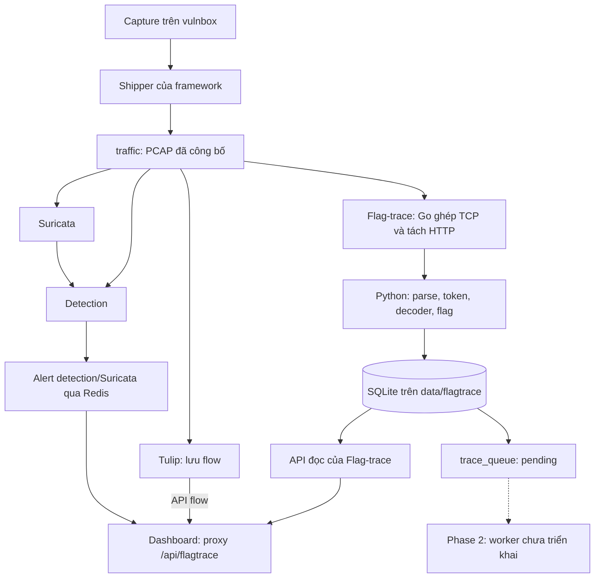

# Flag-trace — Đối chiếu hiện trạng trước khi thiết kế Phase 2

Ngày đối chiếu: **2026-10-14**. Phạm vi: working tree trên branch `feat/decode-dashboard-detection`, HEAD `d65fa11`, **bao gồm các thay đổi Phase 1 chưa commit**. Commit này một mình không tái tạo được hiện trạng mô tả bên dưới.

Tài liệu này ghi nhận nền đã có và những quyết định còn mở để bàn Phase 2. Các mục “cần chốt” là vấn đề thiết kế, chưa phải phương án đã được chọn. Lần đối chiếu này đọc code và tài liệu; các số đo/test lịch sử được dẫn từ báo cáo Phase 1, chưa chạy lại runtime.

Kế hoạch được lập sau bản đối chiếu: [PHASE2_IMPLEMENTATION_PLAN.md](PHASE2_IMPLEMENTATION_PLAN.md). Bản dưới đây giữ nguyên vai trò snapshot hiện trạng; các lựa chọn triển khai đề xuất nằm trong kế hoạch mới.

**1. Cách đọc các nguồn**

| Nguồn | Vai trò khi đối chiếu |
|---|---|
| [ARCHITECTURE.md](ARCHITECTURE.md) | Ý tưởng ban đầu của hệ thống độc lập; schema, cấu hình YAML và ranh giới UI còn thuộc thiết kế cũ |
| [PHASE1_INGEST.md](PHASE1_INGEST.md) | Pipeline A1–A13 và ý định bảo toàn dữ liệu; chưa đồng bộ toàn bộ với implementation |
| [PHASE1_IMPLEMENTATION_PLAN.md](PHASE1_IMPLEMENTATION_PLAN.md) | Các lựa chọn tích hợp vào framework; phân biệt yêu cầu trong kế hoạch với phần đã có code |
| [PHASE1_REPORT.md](PHASE1_REPORT.md) | Kết quả đo/kiểm chứng đã ghi nhận, lỗi còn mở và phạm vi chưa nghiệm thu |
| [PHASE2_TRACE.md](PHASE2_TRACE.md) | Mục tiêu và thuật toán B1–B13; hợp đồng đầu vào và cách vận hành cần cập nhật |
| [Code Flag-trace](../contest-runtime/flagtrace/app/) và [schema.sql](../contest-runtime/flagtrace/app/schema.sql) | Căn cứ cho tên trường, ý nghĩa dữ liệu và hành vi hiện tại |

[Kiến trúc framework cũ](../docs/ARCHITECTURE.md) vẫn mô tả IOC Brain/Ollama/MCP đã bị bỏ. Khi xác định framework hiện tại, đối chiếu [README](../README.md), [Compose](../docker-compose.contest.yml) và code; không đưa các thành phần cũ đó vào nền Phase 2.

**2. Kiến trúc thực tế đã có**

- Capture/ship dùng chung cho framework. Flag-trace đọc PCAP trực tiếp, có parser và database riêng; alert detection và flow Tulip chưa phải đầu vào của trace queue.
- Compose có service `flagtrace`, profile `flagtrace`, container `ctf-flagtrace`, image `ctf-flagtrace:phase1`. DB nằm ở `data/flagtrace/flagtrace.sqlite3`; traffic/config được mount read-only vào container.
- [main.py](../contest-runtime/flagtrace/app/main.py) chạy một vòng ingest, công việc nền và ghi DB; API đọc chạy ở thread riêng. Go helper là process con giữ trạng thái TCP qua nhiều PCAP. Chưa có trace worker.
- HTTP transaction được xuất khi ghép được response, không cần đợi keep-alive đóng. Raw TCP giữ các lượt truyền (`turns`) và được xuất khi connection kết thúc/timeout/đụng giới hạn; phần HTTP lỗi có thể chuyển sang raw.
- SQLite dùng WAL, `synchronous=FULL`, foreign keys và busy timeout. [Store.insert()](../contest-runtime/flagtrace/app/store.py) hiện commit **từng transaction**, chưa gom lô 200 transaction như kế hoạch.
- Config đang để `flagtrace.enabled=false`. Code có tích hợp bật/tắt, healthcheck và offline image; mức kiểm chứng từng phần xem mục 7.

**3. Hợp đồng dữ liệu Phase 1 đang cung cấp**

**3.1. Identity, phạm vi truy vấn và thời gian**

| Thiết kế cũ | Hiện trạng trong code | Hệ quả khi bàn Phase 2 |
|---|---|---|
| `flows.id`, thường minh họa bằng số | `transactions.id`: chuỗi hash 64 hex; unique `(game_id, conn_id, seq_in_conn)` | Dùng `transaction_id` cho bằng chứng và job |
| Bảng `flows` dùng lưu transaction | Connection TCP, transaction Flag-trace và flow Tulip có identity riêng | Liên kết sang Tulip cần mapping riêng; không điền transaction ID vào `flow_id` của dashboard |
| `team_id` dạng số | `team_id` dạng TEXT hoặc NULL; `source_key=team:<id>` / `ip:<địa chỉ>` | Lookup cần scope game/source/service; nguồn chưa biết vẫn có identity riêng |
| B1 loại `team_id IS NULL` | Nguồn chưa map vẫn có thể tạo job nếu response là flag-out candidate | Điều kiện bỏ qua trong B1 cũ không khớp producer hiện tại |
| `ts` dạng giây | `ts_request`, `ts_response`, `ts_end`, `tokens.observed_ts`: integer microseconds | Chuyển đơn vị rõ ràng cho burst/debounce; không trộn với `created` là giây theo giờ xử lý |
| Một timestamp cho mọi token | Consumed dùng đầu request; produced dùng **cuối response**, fallback về đầu request nếu thiếu | Chưa có timestamp riêng chính xác theo từng token; cần chốt so sánh thời gian, tie-break và dữ liệu partial |
| Version dữ liệu/phân tích chưa được mô tả đầy đủ | Có snapshot `config_versions`; transaction cũ bị bỏ qua khi ID đã tồn tại | Đổi cấu hình không tự retag/reindex dữ liệu đã ingest |

ID transport chứa capture source, endpoint và thông tin packet đầu; ID lưu trong DB được scope thêm theo game. Đổi giờ bắt đầu hoặc tick length cho một `game.id` đã tồn tại bị từ chối. Config hash, DB schema version và phiên bản thuật toán trace là ba việc khác nhau.

Nguồn: [config.py](../contest-runtime/flagtrace/app/config.py), [analysis.py](../contest-runtime/flagtrace/app/analysis.py), [store.py](../contest-runtime/flagtrace/app/store.py), [transport/main.go](../contest-runtime/flagtrace/transport/main.go).

**3.2. Raw, parsed, representation và token**

| Nội dung | Hợp đồng thực tế |
|---|---|
| Bytes request/response | Nằm trong `representations`, với `side=req/resp`, `kind=raw/body/decoded`; không có cột `transactions.req_raw/resp_raw` |
| Dữ liệu bị cắt | Có `original_size`, `truncated`, `quality`; giới hạn scan và giới hạn lưu tách riêng. API có thêm `api_truncated` |
| Truy nguồn PCAP | `transaction_pcaps` liên kết nhiều file; raw representation có spans về packet. Metadata còn trong DB không đảm bảo PCAP vẫn còn trên đĩa |
| Header/query/form/cookie | Danh sách giữ phần tử lặp, không phải dictionary như một số ví dụ cũ |
| JSON | `json_pairs` với `__pairs__` cho object, giữ key lặp cả khi lồng nhau |
| Token location | Mảng typed path, được JSON-serialize trong cột `location`; ví dụ `["req","form","name",0]`, `["resp","json","id",0]` |
| Token con | `parent_id` trỏ về token cha, kèm `span` và `transform`; không có cột `parent_value` |
| Giá trị token | `value` và `normalized_value` hiện được gán cùng chuỗi sau bước parse; chưa có một lớp canonicalization tổng quát |
| Ngưỡng độ dài mặc định | `min_len=6` cho body không cấu trúc; `struct_min_len=2` cho vị trí có cấu trúc; `sub_min_len=3` cho token con |
| Độ phổ biến | `token_df.n` đếm một lần/giá trị/transaction; `service_stats.n` là tổng transaction của game/service, gồm cả checker. Chưa có bộ lọc `max_df` trong worker |
| Token giải mã | Extractor có subtoken/base64/JWT claim. Các representation do bộ dò flag tổng quát tạo ra chưa được tự động trích token tiếp |
| Raw TCP | Có `turns` chứa direction/bytes/timestamp/spans; token hiện lấy từ body gộp mỗi chiều, chưa có location kiểu `req.turn[i]` như spec cũ |

Ví dụ token ở `req.form.name` phải được nhận diện bằng location có occurrence, token ID và representation ID. Chuỗi hiển thị `req.form.name` có thể là nhãn UI về sau, chưa phải định dạng lưu hiện tại.

Flag decoder phục vụ tìm flag; token extractor phục vụ nối giá trị giữa các transaction. Một giá trị được tìm thấy sau decode không mặc nhiên có phép thay ngược vào wire bytes. JWT claim được đánh dấu `jwt_unverified`; code chưa cung cấp khả năng sửa và ký lại token. Đây là dữ liệu đầu vào cần tính đến khi định nghĩa mức hỗ trợ của script generator.

Nguồn: [parsing.py](../contest-runtime/flagtrace/app/parsing.py), [tokens.py](../contest-runtime/flagtrace/app/tokens.py), [analysis.py](../contest-runtime/flagtrace/app/analysis.py), [API](../contest-runtime/flagtrace/app/api.py).

**3.3. Flag sighting, classification và queue**

[analysis.enrich()](../contest-runtime/flagtrace/app/analysis.py) ghi sightings trên request và response, ở từng representation. `flags_found` là tập giá trị tìm được trong response. Phân loại hiện tại:

| Classification | Điều kiện chính | Tạo job |
|---|---|---|
| `checker` | Nguồn thuộc checker config | Không |
| `no_flag_observed` | Không thấy flag trong response | Không |
| `echo` | Mọi flag trong response đều có trong request **cùng transaction** | Không |
| `unclassified` | Có flag response còn lại nhưng gặp nhãn mơ hồ/encrypted/protocol chưa hỗ trợ thuộc tập kiểm tra | Không |
| `flag_out_candidate` | Các trường hợp còn lại có flag response | Có |

`flag_out=1` nghĩa là candidate theo quy tắc trên; chưa có kết luận chuỗi exploit đã được tái hiện. Khi response vừa echo một flag vừa chứa flag khác, transaction được enqueue vẫn có thể chứa cả hai trong `flags_found`; Phase 2 cần xác định cách trình bày bằng chứng này.

Row `trace_queue` có `transaction_id`, `game_id`, `schema_version=1`, `status='pending'`, `created`, `attempts=0`, `lease_until`, `error`. Job và transaction/tokens/sightings/DF được ghi trong cùng commit. Primary key hiện chỉ là `transaction_id`.

**Đã có:** durable enqueue và chống tạo thêm job khi ingest trùng. **Chưa có:** claim job, gia hạn lease, retry, reclaim sau crash, đánh dấu hoàn thành, result tables, version phân tích hay outbox cảnh báo. Cột lease có trong schema chưa đồng nghĩa cơ chế lease đã hoạt động. DB hiện là schema **v2**; version **1** trong queue/record transport không phải analysis version.

**3.4. Flag IDs và baseline**

- `flag_ids` có `game_id`, `tick`, `service`, `owner_team_id`, `value`, `source`, `location`, `transaction_id`. `owner_team_id` là đội sở hữu tài nguyên/flag ID; `transactions.team_id` là nguồn request.
- Nguồn hiện có: CLI import JSON (`file`), HTTP trả danh sách đã chuẩn hóa (`configured_http`), suy ứng viên từ checker putflag (`checker_put`). Chưa có adapter tự hiểu mọi API BTC hay trường validity window.
- `checker_put` lấy giá trị ở connection chứa putflag, đến transaction putflag, cả request và response. Chỉ giữ location có giá trị thay đổi qua ít nhất hai tick; loại cookie/header/flag và mảnh tách từ flag. Đó là **ứng viên**: password biến thiên vẫn có thể lọt; tài khoản ở connection khác có thể không được thu.
- `baseline` được rebuild từ tối đa 10.000 HTTP checker transaction trong cửa sổ tick cấu hình. Có sample count, charset, p50/p99, content types, `window_end_tick`, cờ đạt sample limit. Chưa có lịch sử version hay đầy đủ mẫu số tần suất field như spec cũ.
- Trong chế độ `run`, baseline và checker flag IDs được cập nhật sau lượt ingest, theo lịch wall-clock khoảng một tick. CLI ingest cũng rebuild chúng sau khi ingest xong. Job có thể đã được commit trước khi công việc nền chạy.
- `parsing.path_template()` hiện dùng `{n}` cho đoạn số; B7 cũ có thể dùng `{id}` theo vai trò giá trị. Chưa có quy ước chung bảo đảm signature và baseline khớp nhau.

Nguồn: [background.py](../contest-runtime/flagtrace/app/background.py), [main.py](../contest-runtime/flagtrace/app/main.py), [schema.sql](../contest-runtime/flagtrace/app/schema.sql).

**4. Đối chiếu từng bước Phase 2**

Toàn bộ B1–B13 bên dưới là chức năng dự kiến. Cột “nền đã có” chỉ mô tả dữ liệu/hạ tầng hỗ trợ, không tuyên bố các bước này đã được triển khai.

| Bước | Nền đã có | Điểm phải xử lý khi viết lại thiết kế |
|---|---|---|
| B1 — Nhận job | SQLite queue ghi cùng commit với transaction | Scope game/source; unknown IP; claim/retry/lease; thời điểm dữ liệu đủ để trace; phân biệt ingest trùng với nhiều flag-out cùng chain |
| B2 — Nối token | Token role/location/parent/representation, observed time và DF | SQL theo schema thật; ngưỡng theo vị trí; nguồn đầu tiên hay nguồn phù hợp; loại token phổ biến và tie-break. Không coi equality của token là bằng chứng chắc chắn về nhân quả |
| B3 — Cùng connection | `conn_id`, `seq_in_conn` | Spec hiện lấy mọi transaction cùng connection, thiếu giới hạn trước/sau flag-out. Cùng connection không đủ để gán mọi bước là exploit `confirmed` |
| B4 — Burst | Index theo game/source/service/request time | Đổi giây sang microsecond; cách tách nhiều script cùng đội; giới hạn node và giữ riêng bằng chứng thời gian |
| B5 — Lắp chain | Timestamp và thứ tự trong connection | Thứ tự ổn định giữa nhiều connection; quan hệ cạnh và timeline; chain partial, cắt vì giới hạn. `max_depth` trong pseudo-code đang đếm số node, chưa phải độ sâu BFS |
| B6 — Vai trò giá trị | Parent token, transform, flag-ID candidates | Target phải xét đội sở hữu và tick/tuổi flag; hỗ trợ giá trị ngắn; `generated` là suy luận; giá trị derive cần biết khả năng dựng lại |
| B7 — Chữ ký | Hàm path template hiện phục vụ baseline | Cùng quy tắc chuẩn hóa; scope game/service/version; chuỗi endpoint có thể gom chung các bug khác nhau khi bỏ body/query |
| B8 — Gom nhóm | Chưa có bảng signature/chain | Identity nhóm, counter không tăng khi retry, nhiều flag-out chung chain, cập nhật phân loại. B6 ảnh hưởng B7 nhưng B8 chạy lại B6: cần chốt cách giữ/đổi identity nhóm |
| B9 — Bất thường | Baseline checker và sample counts | Thống nhất key path/field, sample tối thiểu, baseline thiếu/cũ, phiên bản bằng chứng. Chưa đủ mẫu không đồng nghĩa hành vi bất thường |
| B10 — Sinh script | Parsed structure, raw/decoded, token và turns | Giữ field lặp/bytes; mapping location; token transform, cookie, TCP turns, dữ liệu cắt. Export script và chạy kiểm chứng là hai thao tác có vòng đời riêng |
| B11 — Lưu báo cáo | SQLite/migration và config snapshot | Schema kết quả, analysis version, commit kết quả + trạng thái job, đọc snapshot nhất quán, retrace khi bổ sung dữ liệu |
| B12 — Cảnh báo | Framework có Redis, Events, WebSocket | Loại event, severity, ID liên kết, tránh trùng với detection, bền vững khi Redis mất. Webhook ngoài framework còn là lựa chọn trong spec |
| B13 — API/UI | Proxy đọc Flag-trace và dashboard hiện hữu | Route chain/signature/export, thao tác đổi trạng thái, phân trang, deep link, cập nhật WebSocket; UI chain chưa có |

Có hai khác biệt thời gian ảnh hưởng trực tiếp B1–B5:

- Transaction được commit theo lúc transport xuất kết quả, không bảo đảm mọi request cũ hơn nó đã hoàn tất trên các connection khác. `ingest_checkpoints.last_ts` và `replay_from` phục vụ tiến độ/recovery; chưa phải mốc cam kết mọi transaction trước một thời điểm đều sẵn sàng để trace.
- Spec vừa đặt `debounce=2s` vừa muốn tạo kết quả trong khoảng 1s. Cần định nghĩa mốc bắt đầu đo, kết quả sơ bộ/cuối cùng và phần nào chạy bất đồng bộ; không dùng mục tiêu trace để hứa độ trễ từ packet tới dashboard.

**5. Các điểm gắn vào framework**

| Thành phần | Hành vi hiện tại | Phần còn mở cho Phase 2 |
|---|---|---|
| [Capture/ship](../contest-runtime/monitor/capture_pull.py) | Session riêng, file đóng, staging `.incoming`, rename và marker `.ready`; live Flag-trace chỉ đọc file có marker | Dùng nguồn capture chung; cách báo gap/backlog vào báo cáo phân tích |
| [Detection](../contest-runtime/detection/service/detection_service.py) | Dò flag theo packet, đưa alert vào Redis | Correlate alert với transaction/chain; tránh dùng alert packet làm dữ liệu thay thế cho transaction |
| [Tulip bridge](../contest-runtime/dashboard/app/routes/tulip.py) | Resolve event bằng thời gian/IP/port/flag, có danh sách candidate | Mở Tulip từ chain thế nào, độ chắc chắn của mapping; không coi ID hoặc bytes của hai hệ là tương đương |
| [API Flag-trace](../contest-runtime/flagtrace/app/api.py) | GET `/health`, `/status`, `/transactions`, `/transactions/{id}`, `/flagouts` | Các bảng/route kết quả, status mutation, export script và giới hạn payload |
| [Dashboard proxy](../contest-runtime/dashboard/app/routes/flagtrace.py) | GET với allowlist route Phase 1; dashboard không mount DB | API mới cần mở rộng cả backend lẫn proxy. Việc service có route mới chưa tự làm route đó truy cập được từ dashboard |
| [Events](../contest-runtime/dashboard/app/routes/events.py), [WebSocket](../contest-runtime/dashboard/app/routes/live.py) | Events đọc `alerts`, `hints`, `audit`; `/ws` relay `alerts_channel`, `hints_channel` | Schema sự kiện chain/signature, severity, reconnect và tải bù từ API |
| [Healthcheck](../contest-runtime/health_check.py), [registry](../contest-runtime/hostagent/registry.py) | Host kiểm tra trạng thái DB và quản lý container Flag-trace; service cũng ghi Redis key `flagtrace_status` | Tách ingest health và trace health, queue age, failure/retry, độ mới dữ liệu |
| [Rules](../contest-runtime/dashboard/app/routes/rules.py), [host agent](../contest-runtime/hostagent/agent.py) | Rule build/test/apply/rollback theo action đã đăng ký; UI Rules hiện tải flow từ Tulip | Cách chuyển bằng chứng chain sang soạn rule nếu cần. Chữ ký gom nhóm exploit chưa phải rule có thể chặn traffic |
| [Retention](../contest-runtime/hostagent/retention.py), [ledger](../contest-runtime/flagtrace/app/ledger.py) | Khóa chung với ingest; chỉ cho xóa PCAP `done` dưới recovery floor; guard còn áp dụng khi DB tồn tại dù module đã tắt | Pin bằng chứng theo chain/job, quota và vòng đời DB/token/report. Chưa có retention dữ liệu SQLite hoặc pin theo chain |
| [Bringup](../bringup.sh), [teardown](../teardown.sh), [offline save](../pull-and-save.sh), [restore](../offline-restore.sh) | Tích hợp profile/image và giữ DB bind mount khi dừng stack | Worker chạy cùng container hay riêng, shutdown, enable/disable, migration và offline packaging |

Redis có memory limit/eviction; Compose hiện không thiết lập queue trace bền vững trong Redis. Phase 1 chỉ publish trạng thái module, chưa phát thêm alert flag-out. Dữ liệu cần tồn tại qua restart hiện nằm ở SQLite.

API Phase 1 cũng chưa thống nhất hoàn toàn cách serialize: list transaction trả một số cột JSON như chuỗi; detail parse một số cột thành object nhưng `tokens.location/transform/span` vẫn là chuỗi JSON. Contract API cho UI Phase 2 cần quyết định rõ, không lấy payload minh họa trong spec làm payload đã có.

Trạng thái `patched` trong spec hiện là metadata dự kiến. Framework có thao tác áp/xóa/rollback rule, nhưng chưa có quan hệ giữa rule, signature và mốc hiệu lực. Flag-out của PCAP cũ ingest sau khi áp rule không tự chứng minh bản vá thất bại; cần xét packet time và bằng chứng liên quan.

**6. Các điểm trong kế hoạch cần đọc cùng giới hạn implementation**

| Nội dung trong kế hoạch | Code hiện tại / giới hạn |
|---|---|
| Contract dataclass/module riêng | Chưa có `contracts.py`; pipeline dùng dict/JSON và schema SQL |
| Một job/transaction/analysis version | Queue chỉ unique theo transaction; chưa có analysis version |
| Token time theo vị trí byte | Consumed/produced hiện dùng thời gian message như mục 3.1 |
| Batch commit khoảng 200 | Hiện một transaction mỗi commit; kiểm tra trùng trong `Store.insert()` diễn ra sau `enrich()` |
| Identity/tiến độ theo game và capture source | Config có `capture_source`, nhưng checkpoint hiện theo game và PCAP có unique `(game_id, hash)`. Chưa có ledger độc lập theo source; chưa coi đây là pipeline đa capture source đã nghiệm thu |
| Luồng phụ baseline/flag IDs | Hiện chạy trong cùng vòng lặp với ingest. Tên “công việc nền” không có nghĩa đã có worker riêng; kế hoạch cũng chưa chốt phải dùng process riêng |
| Theo dõi DB/WAL và lifecycle bằng chứng | Có low-disk check và recovery pin; chưa có quota/GC cho DB, token, report hoặc chain |
| Mọi phần Phase 1 đã đạt nghiệm thu | Báo cáo còn P1.6 chưa kiểm chứng và P1.7 mới một phần |

Các mục này là ranh giới thực tế để tính phạm vi công việc, không phải yêu cầu phải sửa tất cả trước khi được thảo luận Phase 2.

**7. Mức bằng chứng và các tồn đọng đã biết**

Theo [PHASE1_REPORT.md](PHASE1_REPORT.md), không phải kết quả chạy lại trong lần đối chiếu này:

- Dataset A: 713 transaction, 95 job flag-out; 43/95 chỉ thấy qua decoder deflate. Replay/ingest lặp không làm tăng số dòng.
- Dataset B: 20 đội, mỗi đội một IP, 100 tick; 2.000 job, 100 checker putflag, giữ được flag ID theo tick. Số đo lookup token chưa phải nghiệm thu trace engine B2.
- 22 test Flag-trace được báo cáo pass trên host và container; có test atomic commit, replay qua nhiều file, nguồn chưa map, token ngắn, dữ liệu cắt và migration. Chưa có Go test riêng.
- Throughput đã đo khoảng 26–39 transaction/s; decoder là chi phí lớn. DB khoảng 12–15 lần PCAP trong hai dataset. Đây là số liệu trên máy/dataset của báo cáo, chưa phải dự báo tải giải thật.
- Một file PCAP hỏng có thể chặn cả lượt ingest; code hiện vẫn raise khi discovery trả lỗi. Chưa đồng bộ lại HTTP sau `tcp_gap`; nhãn đóng connection và decode budget còn điểm cần sửa.
- Capture handoff với vulnbox thật, retention khi thiếu đĩa, fault injection đầy đủ, E2E Compose và offline restore chưa được báo cáo nghiệm thu đầy đủ. Một container `run` với fixture `.ready` đã được kiểm tra health, phạm vi hẹp hơn E2E.

Config hiện chưa có thông số game/teams để bật Flag-trace; ghi chú capture và `capture_port` cũng cần đối chiếu thực tế trước live. Tài liệu này không thay các giá trị đó bằng giả định.

**8. Danh sách quyết định để bàn Phase 2**

Các mục sau đều **chưa chốt**. Chúng phân biệt lựa chọn kiến trúc với việc đổi tên trường cho khớp schema.

| Mã | Quyết định cần đưa ra | Căn cứ đã có |
|---|---|---|
| D1 | Trace worker chạy ở đâu; ai ghi kết quả, claim job và migration; cách retry mà không tăng counter/phát alert trùng | Một container ingest/API, SQLite queue có sẵn; chưa có consumer hoặc result schema |
| D2 | Khi nào job đủ dữ liệu để chạy; xử lý kết quả partial, thông tin đến muộn và retrace; latency đo từ mốc nào | Open connection, checkpoint, cập nhật baseline/flag IDs và debounce chưa tạo thành contract hoàn tất dữ liệu |
| D3 | Phạm vi chain, cách chọn nguồn token, giới hạn node/cạnh và ý nghĩa confidence | B2–B4 có heuristic; cùng IP/connection/token chưa đủ chứng minh một chuỗi nhân quả |
| D4 | Identity/version của chain và signature; nhiều flag-out chung chain; reclassify có đổi nhóm không | Queue hiện unique theo transaction; B6/B7/B8 có phụ thuộc vòng |
| D5 | Mức hỗ trợ script: HTTP/raw TCP, field lặp, transform, dữ liệu partial; replay kiểm chứng nằm ở đâu | Có raw/parsed/tokens/turns, nhưng chưa có bộ dựng request hoặc runner |
| D6 | UX trong dashboard, contract API và event, liên kết detection/Tulip, webhook có cần trong Phase 2 không | Framework đã có proxy, Events và WebSocket; UI chain chưa có |
| D7 | Ý nghĩa trạng thái phân tích/đã vá; quan hệ với patch/rule; có đưa luồng soạn rule vào phạm vi Phase 2 không | Host agent quản lý rule hiện hữu, chưa có liên kết với signature |
| D8 | Giữ bằng chứng bao lâu, quota/GC, pin/release cho job/chain; hoạt động khi quá tải hoặc thiếu đĩa | Recovery ledger đã có; throughput, DB growth và kiểm chứng retention còn tồn đọng |

Thứ tự thảo luận đề xuất: thống nhất đầu ra người dùng cần ở D5–D7, sau đó chốt contract và cách xử lý dữ liệu ở D2–D4, rồi chọn mô hình worker/lưu trữ/vận hành ở D1/D8. Khi đã có quyết định, cập nhật PHASE2_TRACE.md và kế hoạch triển khai; bản đối chiếu này giữ vai trò mốc hiện trạng ngày 2026-10-14.
