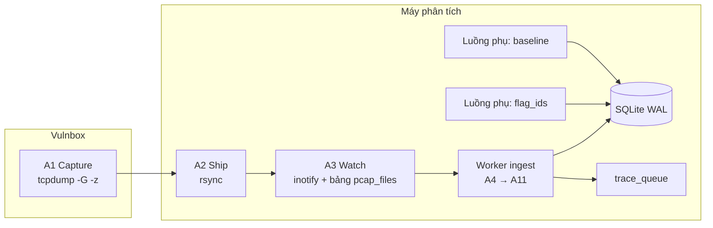

# flagtrace — Giai đoạn 1: Thu thập, phân tích và lưu trữ traffic

> **Đối chiếu 2026-10-14:** pipeline bên dưới là spec ban đầu. Hợp đồng đã triển khai dùng `transactions`, `source_key`, typed locations và SQLite queue; xem [nền tích hợp](INTEGRATION_BASELINE.md) và [báo cáo Phase 1](PHASE1_REPORT.md) để phân biệt code hiện có với yêu cầu còn mở.

> Tài liệu triển khai chi tiết. Mỗi bước ghi rõ **input**, **xử lý**, **output**.
> Mục tiêu duy nhất của giai đoạn 1: ghi DB đúng **hợp đồng đầu vào** của giai đoạn 2 (xem `PHASE2_TRACE.md`, mục 1) và phát sự kiện flag-out.
> Ví dụ xuyên suốt: cùng kịch bản service `notes`, đội 5.

---

## 0. Đích đến

Sau giai đoạn 1, với mỗi transaction đi vào vulnbox, DB có:

- Một dòng trong `flows` với đủ nhãn (đội, service, tick, kết nối, thứ tự), request/response thô và đã giải mã.
- Các dòng trong `tokens` với `location` chính xác, kể cả token con.
- Cờ `flag_out` và danh sách flag tìm thấy.
- Một sự kiện `{"flow_id": ...}` trong hàng đợi trace nếu có flag-out.

Song song, hai luồng phụ cập nhật `flag_ids` (từ BTC) và `baseline` (từ traffic checker).

---

## 1. Thiết kế để gắn vào framework có sẵn

Mỗi bước là một hàm thuần với input/output là dataclass. Framework của bạn có thể thay bất kỳ bước nào (ví dụ đã có sẵn bộ ghép TCP, hoặc đã có bộ decoder flag) miễn là giữ đúng kiểu dữ liệu ở ranh giới.

```python
from dataclasses import dataclass, field

@dataclass
class Chunk:                 # một đoạn dữ liệu liên tục theo một chiều
    direction: str           # "c2s" | "s2c"
    ts: float                # timestamp gói đầu tiên của đoạn
    data: bytes

@dataclass
class Conn:                  # output của A4
    conn_id: str
    src_ip: str; src_port: int
    dst_ip: str; dst_port: int
    start_ts: float; end_ts: float | None
    chunks: list[Chunk]
    complete: bool           # đã thấy FIN/RST chưa

@dataclass
class TaggedConn(Conn):      # output của A5
    team_id: int | None = None
    is_checker: bool = False
    service: str | None = None
    proto: str = "http"      # "http" | "tcp"

@dataclass
class Transaction:           # output của A6
    conn: TaggedConn
    seq_in_conn: int
    ts: float                # thời điểm byte đầu của request
    tick: int
    req_raw: bytes
    resp_raw: bytes
    turns: list[Chunk] | None = None   # chỉ cho TCP thô

@dataclass
class ParsedTransaction(Transaction):  # output của A7
    method: str | None = None
    path: str | None = None
    status: int | None = None
    req_parsed: dict = field(default_factory=dict)
    resp_parsed: dict = field(default_factory=dict)

@dataclass
class TokenRec:              # output của A9
    value: str
    role: str                # "produced" | "consumed"
    location: str
    parent_value: str | None = None
```

Pipeline tổng:

```
pcap ──A4──▶ Conn ──A5──▶ TaggedConn ──A6──▶ Transaction ──A7──▶ ParsedTransaction
                                                                  │
                                         A8 flag detect ◀─────────┤
                                         A9 tokens      ◀─────────┘
                                                │
                                         A10 lưu DB ──A11──▶ trace_queue
```

---

## 2. Tổng quan triển khai vật lý



---

## 3. Các bước chi tiết

### A1 — Capture (trên vulnbox)

**Input:** gói tin trên interface của vulnbox.

**Xử lý:**

```bash
mkdir -p /pcap
tcpdump -i eth0 -s 0 -U \
  -w '/pcap/cap-%Y%m%d-%H%M%S.pcap' -G 60 \
  -z /usr/local/bin/pcap_done.sh \
  'tcp and not port 22'
```

- `-s 0`: lấy nguyên gói (không cắt payload).
- `-G 60`: xoay file mỗi 60 giây (≤ độ dài tick).
- `-z`: chạy script khi một file **đã đóng** → biết chắc file nào an toàn để kéo đi.
- Có thể thu hẹp filter theo port service khi đã biết.

```bash
# /usr/local/bin/pcap_done.sh
#!/bin/sh
mv "$1" /pcap/done/
```

Dọn đĩa: cron xoá file trong `/pcap/done/` cũ hơn N phút sau khi đã được kéo về.

**Output:** file `.pcap` đã đóng trong `/pcap/done/`.

> Đồng bộ giờ: vulnbox và máy phân tích nên chạy NTP. Mọi `ts` lấy từ timestamp trong pcap, `tick` tính từ giờ bắt đầu giải; lệch giờ sẽ làm sai tick.

---

### A2 — Ship

**Input:** `/pcap/done/*.pcap` trên vulnbox.

**Xử lý:** vòng lặp trên máy phân tích:

```bash
while true; do
  rsync -az --remove-source-files root@VULNBOX:/pcap/done/ /data/pcap/incoming/
  sleep 5
done
```

Phương án thay thế: PCAP-over-IP (stream liên tục, độ trễ thấp hơn, nhưng phải tự cắt flow theo thời gian).

**Output:** file pcap trong `/data/pcap/incoming/`.

---

### A3 — Theo dõi và xếp hàng

**Input:** file mới trong `/data/pcap/incoming/`.

**Xử lý:**

- `inotify` (hoặc polling) phát hiện file mới.
- Ghi vào bảng `pcap_files(name, size, status, received_at, processed_at)` với `status = queued`.
- Worker xử lý file **theo thứ tự thời gian** (quan trọng cho A4).
- Xong thì `status = done`, chuyển file sang `/data/pcap/archive/` (giữ lại để tra cứu bản đầy đủ khi body bị cắt).

**Output:** đường dẫn file đưa vào worker, đúng thứ tự.

---

### A4 — Ghép TCP

**Input:** một file pcap + trạng thái các kết nối dở dang từ file trước.

**Xử lý:**

1. Đọc từng gói, nhóm theo 5-tuple.
2. Sắp theo sequence number, bỏ gói truyền lại (retransmission), xử lý gói đến sai thứ tự.
3. Gộp các gói liên tiếp cùng chiều thành một `Chunk`, giữ `ts` của gói đầu tiên trong chunk.
4. Kết nối kết thúc (FIN/RST) → xuất `Conn(complete=True)`.
5. **Kết nối vắt qua hai file pcap** (keep-alive kéo dài qua lúc xoay file): giữ kết nối dở dang trong bộ nhớ, ghép tiếp với file sau. Quá `conn_idle_timeout` (mặc định 120s) không có gói mới → xuất với `complete=False`.
6. Gán `conn_id` = hash(5-tuple + start_ts) để không trùng khi port được tái sử dụng.

Thư viện gợi ý: Go `gopacket/tcpassembly` (nhanh); Python `dpkt`/`scapy` + tự ghép (prototype).

**Output:** danh sách `Conn`. Với ví dụ:

```
Conn c-51234  10.60.5.1:51234 → 10.60.1.1:8080  complete=True
  chunks:
    c2s 10:00:01.120  "POST /register HTTP/1.1\r\n..."
    s2c 10:00:01.130  "HTTP/1.1 200 OK\r\n..."
    c2s 10:00:01.180  "POST /login HTTP/1.1\r\n..."
    s2c 10:00:01.190  "HTTP/1.1 200 OK\r\nSet-Cookie: session=ab12cd9f..."
    c2s 10:00:01.250  "POST /upload HTTP/1.1\r\n..."
    s2c 10:00:01.262  "HTTP/1.1 200 OK\r\n...{\"id\":\"f93a1c\"}"
    c2s 10:00:01.300  "GET /files/f93a1c HTTP/1.1\r\n..."
    s2c 10:00:01.305  "HTTP/1.1 200 OK\r\n...FLAG{a8Kd2xQ9vLm0}"

Conn c-51240  10.60.5.1:51240 → 10.60.1.1:8080  complete=True
    c2s 10:00:01.200  "GET / HTTP/1.1\r\nCookie: session=77ee0b1a..."
    s2c 10:00:01.210  "HTTP/1.1 200 OK\r\n<html>..."
```

---

### A5 — Gắn nhãn kết nối

**Input:** `Conn` + `config.yaml`.

**Xử lý:**

| Nhãn | Cách tính |
|---|---|
| hướng | Chỉ giữ kết nối có `dst_ip` là vulnbox của mình (traffic đi vào). Kết nối mình đi đánh người khác bỏ qua hoặc lưu riêng. |
| `team_id` | Tra `src_ip` trong bảng `teams[*].ips` (hỗ trợ CIDR). Không thấy → `NULL`. |
| `is_checker` | `src_ip` ∈ `checker_ips`. |
| `service`, `proto` | Tra `dst_port` trong `services`. Không thấy → `service = "port:<n>"`, `proto = "tcp"`. |

**Output:**

```
TaggedConn c-51234  team_id=5  is_checker=False  service=notes  proto=http
TaggedConn c-51240  team_id=5  is_checker=False  service=notes  proto=http
```

---

### A6 — Tách transaction

**Input:** `TaggedConn`.

**Xử lý (HTTP):**

- Đọc tuần tự luồng c2s: tách từng request theo `Content-Length` hoặc chunked; luồng s2c tách response tương ứng (bằng parser HTTP như `h11` hoặc tự viết).
- Ghép cặp request ↔ response theo thứ tự (hỗ trợ cả pipelining).
- `ts` = timestamp chunk chứa byte đầu của request.
- `seq_in_conn` = 0, 1, 2, ...
- `tick = floor((ts - game.start_time) / tick_seconds)`.
- Response bị thiếu (kết nối đứt) → `resp_raw = b""`.
- Không parse được HTTP → hạ xuống xử lý như TCP thô.

**Xử lý (TCP thô):**

- Cả kết nối là **một** transaction.
- `req_raw` = nối mọi chunk c2s; `resp_raw` = nối mọi chunk s2c.
- `turns` = danh sách chunk theo thứ tự (cần cho giai đoạn 2 sinh script pwntools: `send` / `recvuntil` theo từng lượt).

**Output:**

```
Transaction #101  conn=c-51234 seq=0 ts=10:00:01.120 tick=42  POST /register
Transaction #102  conn=c-51234 seq=1 ts=10:00:01.180 tick=42  POST /login
Transaction #103  conn=c-51240 seq=0 ts=10:00:01.200 tick=42  GET /
Transaction #104  conn=c-51234 seq=2 ts=10:00:01.250 tick=42  POST /upload
Transaction #105  conn=c-51234 seq=3 ts=10:00:01.300 tick=42  GET /files/f93a1c
```

---

### A7 — Giải mã và parse

**Input:** `Transaction`.

**Xử lý:**

1. Giải `Transfer-Encoding: chunked`, `Content-Encoding: gzip/deflate/br`.
2. Parse request:
   - `headers` (giữ thứ tự, giữ trùng lặp), `cookies` (từ `Cookie`), `query` (đã URL-decode), `path_segments`.
   - body theo `Content-Type`: `application/x-www-form-urlencoded` → `form`; `application/json` → `json`; `multipart/form-data` → `multipart` (tên trường, filename, content-type, nội dung); khác → `raw`.
3. Parse response: `status`, `headers`, `set_cookies` (tên, giá trị, thuộc tính), body theo `Content-Type` như trên.
4. Body lớn hơn `max_body` (mặc định 1 MB): cắt, đánh dấu `truncated = true`, lưu tham chiếu `(pcap_file, conn_id)` để lấy bản đầy đủ khi cần.

**Output** (`req_parsed`/`resp_parsed` của #104):

```json
{
  "req_parsed": {
    "method": "POST",
    "path": "/upload",
    "path_segments": ["upload"],
    "query": {},
    "headers": [["Host", "10.60.1.1:8080"], ["Cookie", "session=ab12cd9f"],
                ["Content-Type", "application/x-www-form-urlencoded"]],
    "cookies": {"session": "ab12cd9f"},
    "body_type": "form",
    "form": {"name": "../../notes/7731.txt"},
    "truncated": false
  },
  "resp_parsed": {
    "status": 200,
    "headers": [["Content-Type", "application/json"]],
    "set_cookies": [],
    "body_type": "json",
    "json": {"id": "f93a1c"},
    "truncated": false
  }
}
```

---

### A8 — Phát hiện flag

**Input:** `ParsedTransaction`.

**Xử lý:**

1. Chạy regex flag trên: `resp_raw`, body đã giải nén, và output của bộ decoder của bạn (base64, hex, reverse, ...).
2. `flags_found` = danh sách flag khác nhau tìm thấy.
3. `flag_out = 1` khi: `flags_found` không rỗng **và** `is_checker = 0` **và** `team_id IS NOT NULL`.
4. **Flag-in** (khuyến nghị): chạy regex trên **request** của checker → ghi `flags_in(flag, flow_id, location, tick)`. Dùng để:
   - Biết chính xác flag của mình (giảm báo động giả do regex khớp nhầm).
   - Dò flag-out đã bị mã hoá theo cách lạ bằng cách tìm giá trị flag đã biết dưới nhiều dạng.

**Output:**

```
#105: flags_found=["FLAG{a8Kd2xQ9vLm0}"]  flag_out=1
các flow khác: flags_found=[]  flag_out=0
```

---

### A9 — Trích token

**Input:** `ParsedTransaction`.

**Xử lý:** duyệt mọi giá trị trong `req_parsed` (role `consumed`) và `resp_parsed` (role `produced`), ghi kèm `location`.

| Nguồn | `location` |
|---|---|
| Cookie request | `req.cookie.<name>` |
| Header request đáng quan tâm (`Authorization`, `X-*`, header không chuẩn) | `req.header.<name>` |
| Đoạn path | `req.path[<i>]` |
| Query | `req.query.<key>` |
| Form | `req.form.<key>` |
| JSON (đệ quy) | `req.json.<a>.<b>` / `req.json.<a>[<i>]` |
| Multipart | `req.multipart.<field>` và `req.multipart.<field>.filename` |
| Set-Cookie | `resp.cookie.<name>` |
| Header response (`Location`, header không chuẩn) | `resp.header.<name>` |
| JSON response | `resp.json.<a>.<b>` |
| Body không cấu trúc (HTML, text) | `resp.body@<start>:<end>` cho chuỗi entropy cao |
| TCP thô | `req.turn[<i>]@<s>:<e>`, `resp.turn[<i>]@<s>:<e>` |

Chuẩn hoá giá trị: URL-decode, bỏ dấu ngoặc kép bao ngoài, trim khoảng trắng.

**Token con:** tách giá trị theo `split_chars` (`/ . _ - = &`), mỗi phần đủ dài thành một token với `location = <cha>.sub[<i>]`, `parent_value = <cha>`.

**Token giải mã:**

- JWT → thêm từng claim: `<location>.jwt.<claim>`.
- Base64 hợp lệ và ra chuỗi in được → thêm `<location>.b64`.

**Lọc tại lúc ghi:** chỉ bỏ giá trị ngắn hơn `min_len` và nằm trong `stoplist`. Lọc theo độ phổ biến (`max_df`) **không** làm ở đây mà để giai đoạn 2 làm lúc truy vấn, vì độ phổ biến thay đổi theo thời gian. Giai đoạn 1 chỉ cập nhật bộ đếm:

```sql
INSERT INTO token_df(service, value, n) VALUES (?, ?, 1)
ON CONFLICT(service, value) DO UPDATE SET n = n + 1;
```

**Output** (với #104):

```
value                  role      location                 parent
ab12cd9f               consumed  req.cookie.session
../../notes/7731.txt   consumed  req.form.name
notes                  consumed  req.form.name.sub[2]     ../../notes/7731.txt   (bị stoplist/df lọc sau)
7731                   consumed  req.form.name.sub[3]     ../../notes/7731.txt   (min_len: xem ghi chú)
f93a1c                 produced  resp.json.id
```

> Ghi chú: `7731` chỉ 4 ký tự, ngắn hơn `min_len = 6`. Token con nên có ngưỡng riêng (`sub_min_len`, mặc định 3), vì flag id thường ngắn và là số.

---

### A10 — Lưu DB

**Input:** `ParsedTransaction`, kết quả A8, danh sách `TokenRec`.

**Xử lý:** một transaction SQLite cho mỗi lô (ví dụ 200 flow) để giảm chi phí ghi:

```python
with db:   # BEGIN ... COMMIT
    flow_id = insert_flow(pt, flags)
    insert_tokens(flow_id, tokens, pt.conn.team_id, pt.conn.service, pt.ts)
    bump_token_df(pt.conn.service, tokens)
    if flags.flag_out:
        enqueue_trace(flow_id)
```

`PRAGMA journal_mode=WAL; PRAGMA synchronous=NORMAL;` để worker trace và UI đọc song song.

**Output:** các bảng như mục 4.

---

### A11 — Phát sự kiện flag-out

**Input:** flow có `flag_out = 1`.

**Xử lý:** ghi `trace_queue(flow_id, status='pending', created)`. Worker trace (giai đoạn 2) lấy theo thứ tự `created`. Ghi trong **cùng** transaction DB với A10 để không bao giờ có sự kiện trỏ tới flow chưa tồn tại.

**Output:**

```json
{"flow_id": 105}
```

---

### A12 — Luồng phụ: flag ids

**Input:** API/trang attack info của BTC (nếu có).

**Xử lý:** mỗi tick gọi một lần, ghi `flag_ids(tick, service, team_id, value)`. Chỉ cần flag id của **đội mình** cho mục đích trace (để nhận ra giá trị `target`), nhưng lưu cả các đội khác để dùng cho phần tấn công.

**Output:**

```
(42, notes, 1, "7731")
```

---

### A13 — Luồng phụ: baseline từ checker

**Input:** các flow `is_checker = 1` trong N tick gần nhất.

**Xử lý:** chạy định kỳ (mỗi tick). Với mỗi `(service, method, path_template, field)` tính:

- tần suất xuất hiện,
- tập ký tự gặp được,
- độ dài p50/p99,
- content-type thường gặp.

`path_template` dùng cùng quy tắc chuẩn hoá với chữ ký ở giai đoạn 2 (B7) để hai bên khớp nhau.

**Output:**

```json
{"service": "notes", "method": "POST", "path_template": "/upload", "field": "req.form.name",
 "freq": 1.0, "charset": "a-z0-9_.", "len_p50": 15, "len_p99": 18,
 "content_types": ["application/x-www-form-urlencoded"]}
```

---

## 4. Lược đồ DB (khớp hợp đồng giai đoạn 2)

```sql
PRAGMA journal_mode = WAL;

CREATE TABLE pcap_files (
  name TEXT PRIMARY KEY, size INTEGER, status TEXT,
  received_at REAL, processed_at REAL
);

CREATE TABLE flows (
  id           INTEGER PRIMARY KEY,
  team_id      INTEGER,
  is_checker   INTEGER NOT NULL DEFAULT 0,
  service      TEXT,
  proto        TEXT,
  tick         INTEGER,
  ts           REAL,
  conn_id      TEXT,
  seq_in_conn  INTEGER,
  src          TEXT,
  dst          TEXT,
  method       TEXT,
  path         TEXT,
  status       INTEGER,
  req_raw      BLOB,
  resp_raw     BLOB,
  req_parsed   TEXT,          -- JSON
  resp_parsed  TEXT,          -- JSON
  turns        TEXT,          -- JSON, chỉ TCP thô
  truncated    INTEGER DEFAULT 0,
  pcap_file    TEXT,
  flags_found  TEXT,          -- JSON array
  flag_out     INTEGER NOT NULL DEFAULT 0
);
CREATE INDEX idx_flows_team_svc_ts ON flows(team_id, service, ts);
CREATE INDEX idx_flows_conn        ON flows(conn_id, seq_in_conn);
CREATE INDEX idx_flows_checker     ON flows(is_checker, service, ts);

CREATE TABLE tokens (
  value        TEXT,
  flow_id      INTEGER REFERENCES flows(id),
  role         TEXT CHECK (role IN ('produced', 'consumed')),
  location     TEXT,
  parent_value TEXT,
  team_id      INTEGER,
  service      TEXT,
  ts           REAL
);
CREATE INDEX idx_tokens_lookup ON tokens(team_id, value, ts);
CREATE INDEX idx_tokens_flow   ON tokens(flow_id);

CREATE TABLE token_df (
  service TEXT, value TEXT, n INTEGER,
  PRIMARY KEY (service, value)
);

CREATE TABLE flags_in (
  flag TEXT PRIMARY KEY, flow_id INTEGER, location TEXT, tick INTEGER
);

CREATE TABLE flag_ids (
  tick INTEGER, service TEXT, team_id INTEGER, value TEXT,
  PRIMARY KEY (tick, service, team_id, value)
);

CREATE TABLE baseline (
  service TEXT, method TEXT, path_template TEXT, field TEXT,
  stats TEXT,                 -- JSON
  updated REAL,
  PRIMARY KEY (service, method, path_template, field)
);

CREATE TABLE trace_queue (
  flow_id INTEGER PRIMARY KEY, status TEXT, created REAL
);
```

Các bảng `signatures`, `chains`, `chain_flows` thuộc giai đoạn 2.

---

## 5. Cấu hình

```yaml
game:
  start_time: "2026-11-01T08:00:00+07:00"
  tick_seconds: 120
  vulnbox_ip: "10.60.1.1"
  checker_ips: ["10.10.0.1", "10.10.0.2"]
  flag_ids_url: "http://10.10.0.1/api/attack.json"   # nếu có

teams:
  1: { name: "us",     ips: ["10.60.1.1"] }
  5: { name: "team05", ips: ["10.60.5.1", "10.61.5.0/24"] }

services:
  notes: { port: 8080, proto: http }
  vault: { port: 1337, proto: tcp }

ingest:
  pcap_incoming: /data/pcap/incoming
  pcap_archive:  /data/pcap/archive
  conn_idle_timeout: 120
  max_body: 1048576
  batch_size: 200

flag:
  regex: "FLAG\\{[A-Za-z0-9_]{16,64}\\}"
  decoders: [base64, hex, gzip, reverse]

token:
  min_len: 6
  sub_min_len: 3
  split_chars: "/._-=&"
  stoplist: ["true", "false", "null", "admin", "user", "login", "notes", "http", "https"]
  interesting_headers: ["Authorization", "X-Auth-Token", "X-Api-Key"]
```

---

## 6. Hiệu năng

- Mục tiêu: xử lý xong một file pcap 60 giây trong < 10 giây, để flag-out được trace trong cùng tick.
- Ghép TCP là phần nặng nhất → ứng viên đầu tiên chuyển sang Go nếu chậm.
- Ghi DB theo lô; index chỉ những gì giai đoạn 2 truy vấn.
- Theo dõi độ trễ: `processed_at - received_at` của `pcap_files`; tăng dần nghĩa là worker đang tụt lại.

---

## 7. Trường hợp biên

| Tình huống | Xử lý |
|---|---|
| Kết nối vắt qua hai file pcap | A4 giữ trạng thái giữa các file, xử lý file theo thứ tự |
| Mất gói, không thấy SYN | Vẫn ghép từ gói đầu tiên thấy được, đánh dấu `complete=False` |
| HTTP pipelining | A6 ghép cặp theo thứ tự |
| Response nén / chunked | A7 giải trước khi parse và chạy regex |
| Body rất lớn | Cắt ở `max_body`, giữ tham chiếu pcap |
| Service dùng TLS | Không đọc được payload; cần tự đặt proxy TLS trước service hoặc dùng key của service |
| WebSocket | Sau `Upgrade`, xử lý phần còn lại như TCP thô (`turns`) |
| Không parse được HTTP trên port HTTP | Hạ xuống TCP thô, không bỏ dữ liệu |
| IP không thuộc đội nào | `team_id = NULL`, vẫn lưu; flag-out không kích hoạt trace nhưng hiện cảnh báo riêng |
| Lệch giờ vulnbox | Tick tính sai → bật NTP; có thể hiệu chỉnh bằng offset trong config |

---

## 8. Kế hoạch kiểm thử

1. **Ghép TCP:** so `req_raw`/`resp_raw` với output của `tcpflow` hoặc "Follow TCP stream" của Wireshark trên cùng pcap.
2. **Kết nối vắt qua file:** chạy service giả với keep-alive dài, xoay pcap mỗi 10 giây, kiểm tra không mất transaction.
3. **Parse:** bộ request mẫu đủ các loại body (form, JSON lồng, multipart, gzip, chunked).
4. **Token:** với kịch bản `notes`, bảng `tokens` phải khớp mục 3 của `PHASE2_TRACE.md` (kể cả `7731` là token con).
5. **Flag:** flag thường, flag base64, flag trong response nén; checker không bị tính là flag-out.
6. **End-to-end:** pcap của kịch bản `notes` → DB → `trace_queue` có đúng `{"flow_id": 105}`.

---

## 9. Đối chiếu với hợp đồng giai đoạn 2

| Yêu cầu của giai đoạn 2 | Bước đáp ứng |
|---|---|
| `flows` đủ nhãn, `seq_in_conn`, `ts` ms | A4, A5, A6 |
| `req_parsed` / `resp_parsed` | A7 |
| `flag_out`, `flags_found` | A8 |
| `tokens` có `location`, token con, `parent_value` | A9 |
| Độ phổ biến token cho `max_df` | A9 (`token_df`) |
| Sự kiện trace | A11 |
| `flag_ids` | A12 |
| `baseline` | A13 |
| `turns` cho TCP thô | A6 |

Bổ sung so với hợp đồng ban đầu, cần cập nhật lại `PHASE2_TRACE.md`:

- Cột `turns` cho TCP thô (giai đoạn 2 dùng để sinh script pwntools).
- Bảng `token_df` (giai đoạn 2 dùng trong `is_noise`).
- Ngưỡng `sub_min_len` riêng cho token con.
- Bảng `flags_in` (tuỳ chọn, giúp B1 loại báo động giả).
