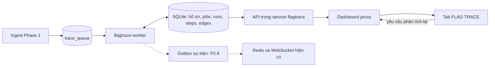

# Flag-trace — Kế hoạch triển khai Phase 2 vào framework

Ngày lập: **2026-10-14**. Trạng thái: **P2.0–P2.3 đã triển khai và nghiệm thu** (fixture + browser + chạy thật end-to-end trên Docker, dataset A/B) — kết quả, lỗi đã sửa và phần chưa kiểm chứng (Compose thật, PCAP thật) trong [PHASE2_REPORT.md](PHASE2_REPORT.md). P2.4a (vai trò giá trị) và P2.5 (HTTP exporter + local verification) đã triển khai, nghiệm thu (PHASE2_REPORT.md mục 13, 15). P2.4b (gom nhóm chain, bước lệch baseline) đã triển khai và nghiệm thu (mục 17). P2.6 đã làm phần dedup trước enrich, cache decoder và chế độ decoder chọn từ dashboard (mục 14); phần còn lại của P2.6 chưa thực hiện. Raw TCP export vẫn chờ turn/byte-span mapping từ Phase 1 như điều kiện P2.5 bên dưới.

Nền đối chiếu: [INTEGRATION_BASELINE.md](INTEGRATION_BASELINE.md). Mục tiêu gốc: [PHASE2_TRACE.md](PHASE2_TRACE.md). Giới hạn Phase 1: [PHASE1_REPORT.md](PHASE1_REPORT.md).

Hướng đã thống nhất trong trao đổi: lấy **hồ sơ trace của một transaction flag-out** làm đơn vị trung tâm; có lịch sử kết quả, timeline và bằng chứng trên dashboard; phát triển theo các mốc dùng được. Các lựa chọn kỹ thuật dưới đây là phương án triển khai đề xuất để hiện thực hóa hướng đó.

**1. Phạm vi và điểm dừng của đợt đầu**

Đợt đầu triển khai **P2.0–P2.3**: từ queue của Phase 1 đến hồ sơ trace có các bước liên quan, lý do nối và request/response xem được trong dashboard. P2.4–P2.6 là các mốc mở rộng tiếp theo; chưa cần triển khai chúng để nghiệm thu đợt đầu.

| Mốc | Đầu ra người dùng nhận được | Phụ thuộc |
|---|---|---|
| P2.0 — Contract và fixture | Mẫu hồ sơ/timeline cùng dữ liệu chuẩn dùng để nghiệm thu | Baseline hiện tại |
| P2.1 — Lưu trữ và worker | Một flag-out tạo một hồ sơ; retry/restart giữ kết quả nhất quán | P2.0 |
| P2.2 — API và dashboard tối thiểu | Mở hồ sơ, xem transaction trả flag và trạng thái xử lý | P2.1 |
| P2.3 — Trace có bằng chứng | Nối các bước, chỉ ra token nguồn/đích, tách phần ngữ cảnh và dữ liệu thiếu | P2.2 |
| P2.4 — Phân tích/gom nhóm | Vai trò giá trị, nhóm chuỗi tương tự, bước đáng ngờ | P2.3 |
| P2.5 — Script | Export từng request rồi cả chain, có trạng thái hỗ trợ/kiểm chứng | P2.4 |
| P2.6 — Vận hành live | Sự kiện realtime, tải bù, quota/retention, benchmark và offline nghiệm thu | P2.3; kiểm tra thêm P2.4/P2.5 khi bật các chức năng đó |

Điểm kết thúc đợt đầu: với fixture `register → login → upload → read`, người dùng xem được đủ bốn bước và bằng chứng cookie/file ID/giá trị request được dùng lại; request rác chen giữa chỉ là ngữ cảnh; dữ liệu cắt hoặc thiếu được thể hiện rõ. Kết quả vẫn truy cập được sau restart.

**2. Các quyết định kiến trúc dùng trong kế hoạch**

1. **Một hồ sơ cho một anchor transaction.** Một response nhiều flag vẫn là một hồ sơ. Hai transaction flag-out có thể chia sẻ node hoặc thuộc cùng nhóm, nhưng không tự nhập hồ sơ chỉ vì chung cookie/connection.
2. **Kết quả có phiên bản.** Hồ sơ có ID ổn định; mỗi yêu cầu phân tích mới có một job và tối đa một kết quả thành công. Retry cùng job không tạo thêm phiên bản. Kết quả cũ tiếp tục xem được.
3. **Worker là service Compose riêng**, `flagtrace-worker`, container `ctf-flagtrace-worker`, dùng chung image với `flagtrace` và chung volume SQLite. Khởi đầu một worker xử lý tuần tự. Cách này tách CPU trace, vòng đời và health khỏi ingest mà không thêm database hoặc hệ thống queue.
4. **SQLite lưu job và kết quả.** Giữ `trace_queue` hiện tại làm sự kiện flag-out từ ingest; thêm bảng job cho retry/retrace/version. Redis chỉ chuyển thông báo tới dashboard ở mốc sau.
5. **Worker đọc dữ liệu đã ingest.** Mount DB và config; không cần mount PCAP, Docker socket hay SSH. Truy vấn metadata/token trước, chỉ lấy payload của các bước thực sự cần. Phase 2 dùng representations sẵn có, không chạy lại toàn bộ decoder flag.
6. **Dashboard là giao diện chung.** Thêm tab `FLAG TRACE`, mở rộng proxy `/api/flagtrace`, giữ Events/Rules/Tulip là các chức năng của framework. Metadata trace do API Flag-trace quản lý; thao tác lên host/rule vẫn đi qua host agent.
7. **Phân biệt trạng thái chạy và độ đầy đủ bằng chứng.** Job `done` chỉ nghĩa là xử lý xong snapshot hiện có. UI không diễn giải thành đã tìm đủ exploit hoặc đã tái hiện thành công.



Đây là sơ đồ đích của kế hoạch. Hiện tại chỉ producer `trace_queue`, DB ingest và proxy đọc Phase 1 đã tồn tại.

**3. Contract của hồ sơ và kết quả**

Ba identity tách biệt:

| Đối tượng | Identity và vai trò |
|---|---|
| Transaction | `transaction_id` của Phase 1; một cặp request/response hoặc đoạn raw TCP đã được ingest |
| Hồ sơ trace | `trace_id = uid("trace", game_id, anchor_transaction_id)`; tồn tại qua các lần phân tích |
| Kết quả phân tích | `run_id` gắn duy nhất với một `job_id`; ghi engine version, trace config và dữ liệu đã dùng |

`transaction_id`, `trace_id` đều khác ID flow Tulip. Tham chiếu sang Tulip về sau đặt trong trường riêng có nguồn và mức chắc chắn.

Mỗi kết quả chứa:

- Anchor: game, service, source key, team/IP, tick, packet timestamps, transaction trả flag và flag sightings liên quan.
- `steps`: danh sách transaction theo thứ tự hiển thị, cùng vai trò và các lý do được thêm vào.
- `edges`: source/destination transaction **và token ID**, typed location, representation, transform, thời gian quan sát và loại bằng chứng.
- `coverage`: phạm vi thời gian đã xét, snapshot time, chất lượng packet/message, giới hạn đã chạm, nguồn giá trị chưa giải thích được.
- `analysis`: engine version, hash/snapshot trace config, các ingest config version được gặp, thời gian chạy và số query/node/edge.
- Các mục mở rộng P2.4/P2.5: vai trò giá trị, grouping, suspects, script artifacts. Chưa chạy mục nào thì trả trạng thái `not_computed`, không giả lập kết quả rỗng như đã phân tích.

Vai trò của bước dùng trong đợt đầu:

| Vai trò | Ý nghĩa trên UI |
|---|---|
| `anchor` | Transaction mà Phase 1 quan sát được flag response và enqueue |
| `data_linked` | Có cạnh nối giá trị; cạnh ghi rõ response truyền giá trị hay suy nguồn từ request dùng lại |
| `context` | Gần theo connection/thời gian; chưa có cạnh dữ liệu đủ để đưa vào nhóm trên |

Một bước có thể có nhiều `reasons`; nâng từ context sang data-linked vẫn giữ các lý do. Vai trò không khẳng định request đó khai thác bug. Thông tin thiếu/cắt nằm trong quality riêng, không ép vào một điểm confidence duy nhất.

Payload hồ sơ/run chỉ mang metadata, tham chiếu và đoạn trích có giới hạn. Request/response đầy đủ lấy qua API evidence để tránh nhân bản BLOB vào mỗi run và mỗi lần tải danh sách.

**4. Schema, migration và quyền ghi**

Mở rộng schema hiện tại bằng migration từ v2. Tách phần khởi tạo/migration ra khỏi `Store` để worker mở DB mà không vô tình ghi lại game/config/team hay chạy DDL.

| Bảng dự kiến | Trường/ràng buộc cần có |
|---|---|
| `trace_profiles` | `id`, `game_id`, `anchor_transaction_id`, `created`, `last_requested_sequence`, `latest_run_id`, `latest_run_sequence`; unique `(game_id, anchor_transaction_id)` |
| `trace_jobs` | `id`, `trace_id`, `request_sequence`, `trigger_key`, `engine_version`, trace config hash/snapshot, `status`, `available_at`, `attempts`, `lease_owner`, `lease_token`, `lease_until`, `error`, timestamps; unique `(trace_id, trigger_key)` và `(trace_id, request_sequence)` |
| `trace_runs` | `id`, `job_id UNIQUE`, `trace_id`, `request_sequence`, engine/config version, snapshot metadata, coverage/warnings/metrics và timestamps; kết quả đã commit là immutable |
| `trace_steps` | `(run_id, transaction_id)` unique; position, role, reasons, quality; FK về transaction |
| `trace_edges` | Run, endpoint transaction/token IDs, evidence kind, locations/representations, ambiguity và thời gian; unique evidence key trong run |
| `trace_runtime_status` | Game/worker, heartbeat, job hiện tại, trạng thái, error gần nhất; tách khỏi `runtime_status` của ingest |

Index phục vụ lấy pending job theo `(status, available_at)`, job theo trace/sequence, kết quả theo trace và steps theo transaction. Danh sách hồ sơ join anchor để lọc game/source/service/tick. Chỉ thêm index sau khi xác định query sử dụng; theo dõi chi phí dung lượng.

**Giữ ranh giới producer:** Phase 1 tiếp tục insert `trace_queue` trong commit với transaction. Dispatcher trong worker tạo profile + initial job rồi đổi queue row sang `dispatched` **trong cùng commit**. Các cột lease cũ của `trace_queue` không trở thành nguồn lease thứ hai; lease thực thi nằm ở `trace_jobs`. Metric cũ `pending_trace_jobs` cần tách thành pending dispatch và pending/running/failed analysis để không báo backlog đã hết chỉ vì đã dispatch.

**Migrate:** khi triển khai phiên bản mới, dừng hai writer Flag-trace, tạo backup SQLite nhất quán, chạy lệnh `migrate`, rồi mới khởi động ingest/API và worker. Worker chỉ kiểm tra schema tương thích. Migration chạy lại không nhân đôi dữ liệu; DB v1 đi qua migration v2 rồi tới bản mới; giữ các transaction, DF, pending queue và recovery checkpoint cũ. Backfill profile/job dùng dispatcher có giới hạn mỗi lượt, không chạy trace nặng bên trong migration.

**Ghi đồng thời:** ingest, worker và endpoint yêu cầu retrace dùng connection riêng. Claim/commit/enqueue là transaction ghi ngắn; không giữ write lock trong lúc truy ngược, dựng báo cáo hoặc gọi mạng. SQLite vẫn chỉ có một writer tại một thời điểm; WAL hỗ trợ reader, không thay thế cơ chế retry khi DB bận. API đọc không gọi hàm khởi tạo/migration.

**5. Vòng đời job, snapshot và phục hồi**

Luồng thực thi:

1. Dispatch có giới hạn các queue row `pending` của game đang chạy. Initial job dùng trigger key ổn định; replay cùng PCAP không sinh profile/job mới.
2. Claim một job tới hạn bằng transaction `BEGIN IMMEDIATE`; tăng attempts và sinh lease token mới. Job hết lease được reclaim bằng token khác.
3. Đọc metadata/token trong một read transaction có giới hạn thời gian, theo cùng snapshot. Release snapshot trước commit kết quả; không giữ reader qua gọi mạng hoặc chờ người dùng. Payload lấy có giới hạn và chỉ cho node đã chọn.
4. Tính kết quả theo engine/config của job; deadline hết thì lưu kết quả partial với lý do và số liệu, thay vì đánh dấu đã tìm đủ chain.
5. Commit run + steps + edges + trạng thái job `done` trong một transaction, chỉ khi lease token còn hợp lệ. Cập nhật latest pointer bằng `request_sequence` để job cũ hoàn thành muộn không ghi đè kết quả mới hơn.
6. Lỗi tạm thời đưa job về pending với backoff; quá số lần thử chuyển failed và giữ error xem được. Shutdown ngừng claim, hoàn tất hoặc nhả job đang làm theo giới hạn stop grace; crash được xử lý bằng lease expiry.

Một job có tối đa một successful run. Crash sau commit nhưng trước khi process báo thành công không tạo thêm run/counter. Worker cũ đã mất lease không được commit. Yêu cầu retrace có idempotency key; gửi lại cùng yêu cầu trả cùng job, còn một yêu cầu mới tạo sequence mới và giữ lịch sử cũ.

`request_sequence` được cấp bằng cách tăng counter trên profile trong cùng commit enqueue; không lấy số lượng run làm sequence. Counter không giảm khi dọn lịch sử. Nếu job mới failed, UI vẫn giữ last successful run và hiển thị lỗi của yêu cầu mới riêng.

**Snapshot và dữ liệu đến muộn:** đợt đầu chạy một lần trên dữ liệu đã commit lúc thực thi; cho phép retrace thủ công từ P2.3. Không coi `ingest_checkpoints.last_ts` là mốc mọi transaction đã hoàn tất. Kết quả ghi snapshot time, các transaction/token sử dụng và chất lượng ingest liên quan. Retry chưa có kết quả có thể đọc snapshot mới hơn; lần thành công lưu manifest của snapshot thực sự đã dùng. Đây là chống trùng hiệu ứng, không phải cam kết mọi lần thử thấy cùng một dataset.

Luôn thể hiện “phân tích trên dữ liệu hiện có”. Những connection chưa xuất đủ transaction, baseline/flag IDs chưa cập nhật, capture gap hoặc late file là lý do có thể cần retrace. Cơ chế tự retrace có giới hạn sẽ được thêm ở P2.6; không tự chờ debounce 2 giây rồi tuyên bố dữ liệu đã đầy đủ. Bộ đếm phiên bản input để kích hoạt retrace tự động phải được thiết kế ở mốc đó.

**6. Thuật toán đầu tiên cho P2.3**

**Phạm vi mặc định:** cùng `game_id`, `source_key` và service; bỏ checker trong tập tiền nhiệm. Nguồn chưa map đội vẫn trace theo IP. Anchor giữ nguyên tập sightings, phân biệt flag echo cùng transaction với flag response bổ sung. Không dùng chính flag làm token nối mọi request lại với nhau.

Thứ tự xử lý:

1. Tạo node anchor và đọc consumed tokens. Giữ location/parent/representation; giới hạn số token được xét mỗi node theo ưu tiên trường có cấu trúc trước body tự do.
2. Lọc noise theo vị trí, stoplist và DF. Chỉ dùng tỷ lệ DF khi đủ số mẫu; với fixture vài transaction, không loại session chỉ vì nó xuất hiện ở 3/4 dòng. Ngưỡng `struct_min_len`/`sub_min_len` theo Phase 1; lọc token dùng để nối không được xóa giá trị cần cho target classification ở P2.4.
3. Tìm candidate trước transaction đích bằng index token, giới hạn kết quả. Ưu tiên nguồn response có cấu trúc và thời gian phù hợp; nếu có nhiều nguồn tương đương thì ghi ambiguity và các lựa chọn thay thế. Không âm thầm nối tất cả candidate thành core chain.
4. Khi không có nguồn produced phù hợp, xét lần dùng đầu trong request có trường tương thích để nối register/login. Cạnh mang loại `request_reuse` và ghi rõ đây là suy nguồn từ tái sử dụng, khác với `response_to_request`.
5. Ràng buộc thời gian: produced token phải quan sát trước khi request đích sử dụng; không lấy thời gian đầu request nguồn thay cho cuối response. Timestamp bằng nhau chỉ dùng thứ tự connection/sequence khi có căn cứ; cross-connection không phân biệt được thứ tự thì giữ ambiguity. Bỏ self-edge và bảo vệ chống cycle.
6. BFS có giới hạn depth, tổng nodes, edges, candidates/query và thời gian riêng biệt. Lookup token có thể đi về tài khoản tạo từ lâu; dùng index + limit, không quét toàn bộ lịch sử.
7. Bổ sung context cùng connection và burst trong cửa sổ cấu hình, luôn giới hạn về phía trước anchor theo packet time. Không kéo request tương lai vào chain. Context không tự mở rộng BFS token trong bản đầu để tránh lan qua traffic rác.
8. Sắp timeline ổn định bằng timestamp và connection/sequence/ID; lưu graph cạnh riêng. Thứ tự hiển thị giữa các connection có timestamp bằng nhau không được trình bày như chứng minh nhân quả.

Ranking đầu tiên: source response có cấu trúc trước body tự do; trong cùng mức bằng chứng ưu tiên predecessor cùng connection khi thứ tự sequence phù hợp, rồi nguồn produced gần nhất trước destination. Request-reuse fallback lấy nguồn consumed sớm nhất ở loại trường tương thích. ID chỉ làm tie-break để output ổn định, không tăng độ tin cậy. Nếu nhiều nguồn tương đương vẫn không phân biệt được, trả nhánh chưa giải thích được và alternatives trong giới hạn; script generator về sau phải đọc trạng thái đó. Có fixture riêng cho mỗi quy tắc chọn nguồn.

`max_query_rows` là tổng row được đọc cho một job, không phải hạn mức cho từng query. Lưu cả số token/candidate bị bỏ vì budget để người xem phân biệt không có liên kết với chưa tìm hết.

Phạm vi đầu hỗ trợ nối HTTP bằng dữ liệu có cấu trúc. Raw TCP vẫn có hồ sơ, anchor, turns và evidence; mức nối tự động/sinh script theo lượt sẽ được nghiệm thu riêng, vì token Phase 1 hiện nằm ở body gộp mỗi chiều.

**7. API và dashboard của đợt đầu**

API nội bộ được dashboard proxy dưới `/api/flagtrace`. Mọi lookup kiểm tra game hiện hành và quan hệ trace/run/transaction, không chỉ kiểm tra ID hợp lệ.

| Route đề xuất | Nội dung | Mốc |
|---|---|---|
| `GET /traces` | Danh sách profile, anchor summary, latest result và trạng thái job; lọc source/service/tick/state, cursor theo `(ts_request, trace_id)` | P2.2 |
| `GET /traces/{id}` | Header hồ sơ, latest run và job summary | P2.2 |
| `GET /traces/{id}/runs` | Lịch sử kết quả có phân trang | P2.2 |
| `GET /traces/{id}/runs/{run_id}` | Steps, edges, coverage, warnings, metrics và manifest | P2.2 |
| `GET /transactions/{id}/evidence` | Parsed fields/locations ở dạng JSON có kiểu, representations dạng base64, sightings, tokens và tình trạng dữ liệu | P2.2 |
| `GET /trace-status` | Heartbeat và backlog/lease/failure của worker, tách ingest status | P2.2 |
| `POST /traces/{id}/retrace` | Tạo job mới theo idempotency key, trả 202 và job ID | P2.3 |

Route evidence mới dùng DTO thống nhất để tránh phụ thuộc cách trả chuỗi JSON lồng của endpoint Phase 1. Giữ endpoint cũ hoạt động; phải đặt router evidence trước nhánh bắt mọi `/transactions/...` đang có. Trả `api_version`, dữ liệu cắt và availability rõ ràng; áp giới hạn payload/tokens/edges ở server.

POST retrace chỉ enqueue thao tác phân tích nội bộ, không chạy exploit/rule/SSH. Dashboard không mount SQLite; proxy kiểm tra method/path/body theo allowlist cụ thể, không thành proxy tùy ý.

Tab `FLAG TRACE` gồm danh sách hồ sơ, timeline và panel evidence. Hiển thị source/team, service, packet time/tick, số flag, trạng thái job và cảnh báo chất lượng. P2.2 chỉ có anchor với nhãn “chưa dựng liên kết”; P2.3 bổ sung graph/timeline thực.

- Bấm một node tải request/response; bấm cạnh làm nổi token nguồn/đích theo representation/location. Offset decoded không được tô trực tiếp lên raw bytes. Nếu bytes đã bị cắt, chỉ ra giới hạn hiển thị.
- Có view lịch sử run; chọn run cũ giữ đúng bằng chứng/version của run đó.
- Route hash đề xuất `#flagtrace/<trace_id>`; sửa parser router hiện tại để không làm hỏng `#events`, `#rules`, các tab cũ và browser back/forward.
- Ban đầu polling khi tab đang mở và trang visible; dừng timer khi rời tab. Phân biệt disabled, worker lỗi, pending, không có dữ liệu và kết quả partial. P2.6 mới bổ sung push trên WebSocket hiện hữu.
- Dữ liệu packet được render bằng text/escaping, kiểm tra fixture chứa HTML/script để evidence viewer không thực thi nội dung capture.

**8. Config và vòng đời triển khai**

Mở rộng dưới `flagtrace.trace` trong `services.json`; mặc định tắt nếu block chưa tồn tại. Các con số sau là **giá trị khởi đầu để test/tune**, không phải số liệu đã benchmark:

```json
{
  "flagtrace": {
    "enabled": false,
    "trace": {
      "enabled": false,
      "poll_seconds": 1,
      "lease_seconds": 30,
      "max_attempts": 3,
      "algorithm_budget_ms": 1000,
      "max_depth": 8,
      "max_nodes": 64,
      "max_edges": 256,
      "max_tokens_per_node": 128,
      "max_candidates_per_token": 8,
      "max_query_rows": 5000,
      "same_service_only": true,
      "context_window_seconds": 60,
      "burst_gap_seconds": 3,
      "token_max_df": 0.3,
      "df_min_samples": 100
    }
  }
}
```

Validator kiểm tra các số hữu hạn/dương, quan hệ lease/deadline và việc bật trace cần bật Flag-trace. Bản đầu chỉ hỗ trợ `same_service_only=true`; giá trị false phải bị từ chối rõ ràng, tránh quảng cáo cross-service trace chưa nghiệm thu. Hash cấu hình thuật toán tách khỏi poll/lease để đổi lịch polling không tạo nghĩa phân tích mới. Job giữ snapshot cấu hình, không đọc config đang thay đổi giữa chừng.

Compose dùng cùng image `ctf-flagtrace:phase2` cho hai service; build/save một image chứa hai entrypoint. Worker chạy lệnh `trace`, API/ingest tiếp tục `run`; CLI thêm `migrate`, `trace-once` và kiểm tra worker status phục vụ fixture/health. `trace-once` lấy job từ DB và thực thi cùng engine với live, không có đường xử lý riêng chỉ dành cho test.

Bringup quản lý migration và thứ tự khởi động như mục 4. Tắt riêng `flagtrace.trace.enabled` dừng worker và giữ DB/jobs/history; ingest tiếp tục. Registry, Config Save & apply, healthcheck, teardown và offline scripts cần biết cả hai container. Worker chỉ phụ thuộc DB/schema sẵn sàng; ingest bị degraded không tự chặn khả năng phân tích dữ liệu lịch sử còn dùng được.

Khi nâng schema, giữ backup trước migrate và ghi rõ binary/schema compatibility. Tắt trace là đường lui vận hành của bản mới; không khẳng định image Phase 1 đọc được DB đã nâng cấp.

**9. Công việc và điều kiện qua từng mốc**

**P2.0 — Chốt contract và fixture**

- Tạo `trace/contracts.py`: profile/run/node/edge/coverage, enum trạng thái và version; chuẩn hóa serialized DTO cho API. Graph engine nhận repository interface và trả result có cấu trúc; không phụ thuộc Redis/FastAPI/HTML.
- Viết schema migration dự kiến và mẫu response API cho pending, seed-only, linked, partial, failed. Dùng mẫu này để thống nhất UI trước khi nối worker.
- Mở rộng [fixture notes hiện có](../contest-runtime/flagtrace/tests/fixtures.py): thêm checker/flag ID, request rác trên connection khác, request sau flag-out, hai chuỗi xen kẽ cùng đội và các connection riêng cho từng bước. Giữ fixture gốc để regression.
- Lập expected nodes/edges bằng ý nghĩa request/token, không hardcode ID số 101–105 của tài liệu cũ. Có trường hợp chỉ một bước đọc flag để kiểm tra chain ngắn hợp lệ.

Qua mốc khi contract biểu diễn được các trường hợp trên mà không nhập nhằng transaction/trace/Tulip ID, thời gian packet/processing hoặc execution/evidence status. Fixture và kỳ vọng phải tồn tại trong repo, không chỉ trong thư mục báo cáo gitignored.

**P2.1 — Migration, queue và worker tối thiểu**

- Thực hiện migration và repository theo mục 4; dispatcher chuyển các job Phase 1 đang pending thành profile/initial job theo batch nhỏ. Worker giai đoạn này tạo run chỉ gồm anchor, ghi `not_computed` cho token linking.
- Thực hiện claim/lease/retry/fencing theo mục 5, bounded DB-busy retry, shutdown và heartbeat riêng. Deadline computation/read snapshot phải nhỏ hơn lease; tác vụ mở rộng chạy lâu cần gia hạn lease hoặc tách job, không kéo dài write transaction.
- Thêm service/entrypoint, enable/disable và health. Giữ default concurrency 1; nếu hai worker vô tình chạy, unique constraint và lease vẫn bảo vệ việc hoàn thành job.
- Sửa lỗi Phase 1 **một PCAP hỏng chặn mọi file**: ghi nhận file lỗi bền vững, cho các file hợp lệ tiến tiếp, báo degraded/gap và giữ chính sách late/reimport rõ ràng. Không đánh dấu dữ liệu qua chỗ lỗi là đầy đủ; tránh retry vô hạn cùng file lỗi trong mỗi poll.

Qua mốc khi: ingest trùng chỉ có một profile/initial job; nhiều flag trong một response vẫn một profile; crash ở trước/sau claim và trước/sau commit không làm mất job hoặc tạo hai run; stale lease bị từ chối; một file lỗi đi cùng file tốt vẫn tạo được hồ sơ từ file tốt với cảnh báo gap.

**P2.2 — API và dashboard dùng được**

- Thêm GET routes, DTO evidence, pagination và proxy allowlist. Metadata list không tải toàn bộ payload hoặc decode lại flag.
- Thêm tab/list/timeline/panel evidence và hash navigation; seed-only run có một node anchor cùng nhãn phân tích liên kết chưa chạy. Job đang chờ hoặc failed vẫn xuất hiện và có trạng thái rõ.
- Test hiển thị decoded/raw đúng representation, duplicate field location, missing response, truncated bytes, unknown source, disabled worker, request lỗi và nội dung capture chứa HTML/script.

Qua mốc khi mở dashboard từ một DB fixture mới ingest, xem được hồ sơ/flag evidence, refresh/deep link/history hoạt động, service restart giữ dữ liệu; các tab Monitor/Events/Rules/Services vẫn dùng được. Kiểm tra qua browser thật, không chỉ kiểm tra JSON API.

**P2.3 — Trace engine và retrace thủ công**

- Thực hiện token lookup, candidate ranking, ambiguity, request-origin fallback và context như mục 6. Bổ sung query counters/giới hạn trước khi chạy dataset lớn.
- Gắn kết quả engine vào cùng đường persist/API/UI đã có; xem và chọn run lịch sử. Endpoint retrace tạo job mới, không sửa run cũ.
- Tạo bằng chứng cho cả node/edge và lý do bị cắt: giới hạn node/query/time, thiếu source, gap, chất lượng decode hoặc token đã bị Phase 1 giới hạn.
- Nghiệm thu fixture tách connection để chứng minh bốn bước được tìm bằng liên kết dữ liệu, không vô tình pass nhờ tất cả nằm trong cùng TCP connection.

Qua mốc khi đủ kịch bản A1–A12 ở mục 11. Sau P2.3 dừng đợt đầu để đánh giá trên PCAP thật; kết quả được ghi thành báo cáo riêng trước khi mở rộng phân loại/script. Đây là nghiệm thu offline/MVP, chưa thay thế điều kiện bật live ở P2.6.

**P2.4 — Vai trò giá trị, nhóm và bất thường**

- B6 đọc typed locations/parent spans và flag IDs từ cả import/HTTP/checker_put. Phân biệt đội gửi request với đội sở hữu target; xét tick gốc và cửa sổ flag còn hợp lệ do config giải cung cấp. Không có thông số validity thì ghi rõ mức hỗ trợ, không tự đoán tick cũ đã hết giá trị.
- Phân loại `generated`/`linked`/`target`/`constant`/`unknown` có evidence và ambiguity. Giá trị ngắn cần đối chiếu cả parsed fields vì token 1 ký tự có thể không được ingest. JWT/transform không đảo ngược giữ trạng thái unresolved cho export.
- Dùng một normalizer có version chung cho baseline và signature. Bản đầu grouping dựa trên cấu trúc các bước anchor/data-linked, loại context; identity nhóm không phụ thuộc kết quả suy `generated` để tránh vòng B6 → B7 → B8 → B6.
- Lưu grouping theo từng run và current membership theo profile. Hit count tính theo các anchor/profile riêng biệt, không theo số retry/retrace. Group chỉ mang nghĩa các chuỗi tương tự; không khẳng định tất cả khai thác cùng bug.
- Snapshot baseline/flag-ID/DF evidence dùng cho phân loại và anomaly trong run; nâng phân loại từ nhiều chain tạo run mới khi yêu cầu, không sửa âm thầm báo cáo cũ.

Nghiệm thu: thay cookie/username/file ID qua nhiều lần vẫn gom được fixture cùng cấu trúc; retrace không tăng hit count; hai nguồn không nối chéo; baseline thiếu/mẫu ít không bị coi là bằng chứng chắc chắn về bug; `7731` từ checker trở thành target/template đúng mà không tạo cạnh nối sang checker. Baseline/flag IDs bổ sung sau đó chỉ đổi phân tích khi tạo run mới; xem run cũ vẫn thấy kết luận và evidence cũ.

**P2.5 — Export và tái hiện**

- Bắt đầu từ script từng request, sau đó HTTP chain có liên kết rõ. Script artifact gắn với `run_id`, engine/exporter version và hash; kết quả cũ không đổi khi exporter được nâng cấp.
- Giữ body binary, field/header/query lặp và encoding có ý nghĩa; nếu thư viện HTTP chuẩn hóa làm đổi payload thì cung cấp raw request artifact hoặc đánh dấu chưa hỗ trợ. So wire bytes/semantic request khi test, không chỉ kiểm tra script chạy không lỗi.
- `linked` bóc từ response theo location; `session_cookie` dùng session khi semantics phù hợp; `generated` chỉ tự thay khi có căn cứ và ràng buộc định dạng; target thành tham số. Ambiguous/unknown giữ TODO và trạng thái cần chỉnh sửa.
- Raw TCP cần mapping turns/byte spans từ Phase 1 trước khi export chuỗi send/receive đúng; nghiệm thu riêng khỏi HTTP. Không giả định script TCP đúng chỉ vì có một transaction chứa đủ bytes hai chiều.
- Replay kiểm chứng chạy bằng CLI/fixture local riêng, ghi target fixture, thời gian và artifact hash. `reproduced` chỉ được đặt khi có lần chạy kiểm chứng tương ứng; UI copy/export không tự chạy script vào service đang thi.

Nghiệm thu: chạy script chain trên fixture với session/file ID mới vẫn lấy flag đúng; field lặp và payload encoding được bảo toàn; case unsupported/ambiguous hiển thị giới hạn thay vì nhận nhãn đã tái hiện. Webhook ngoài framework và replay điều khiển từ dashboard là phần mở rộng nếu cần, không nằm trên đường xử lý job đầu tiên.

**P2.6 — Realtime, retention và nghiệm thu live**

- Thêm outbox SQLite trong commit kết quả/group change; relay sang Redis dùng `event_id` ổn định. Delivery có thể lặp khi crash giữa publish và đánh dấu sent: consumer/UI phải dedup theo ID; reconnect tải trạng thái từ API. Notification không là nơi duy nhất giữ kết quả.
- Dùng event trace-ready/group-new và ID có kiểu riêng; không ghi transaction ID vào `flow_id`. Trace-ready bổ sung link phân tích, tránh phát thêm còi flag-out cho từng alert detection đã có. Correlation sang detection/Tulip ghi candidate và mức chắc chắn.
- Thêm coalesced retrace khi input liên quan thay đổi, với revision/counter input được commit cùng dữ liệu, retry window và số lần chạy tự động có giới hạn. Nếu không xác định được input liên quan thì dùng retrace thủ công, không quét lại mọi profile mỗi tick.
- Metadata đánh dấu đã xử lý/đã vá lưu mốc hiệu lực và ghi chú/rule reference khi có. Traffic cũ ingest muộn không được dùng để kết luận xử lý thất bại. Soạn/test/apply rule tiếp tục theo luồng host agent hiện có.
- Retention theo quan hệ profile/run → transaction/token/representation: giữ bằng chứng mà run còn tham chiếu; xóa có thứ tự và grace period khi job đang chạy. Giữ latest run và giới hạn history theo policy; dọn job/outbox/artifact đã hết hạn theo batch.
- PCAP recovery pin của Phase 1 tiếp tục độc lập. Hồ sơ đọc từ DB nên không pin mọi PCAP vô hạn; trường hợp cần bảo toàn raw đầy đủ phải có pin với quota/TTL rõ. PCAP đã hết retention hiển thị unavailable. Thiếu đĩa phải báo degraded và dừng nhận việc tại ngưỡng, không xóa bằng chứng còn được bảo vệ.
- Đo/tối ưu Phase 1: batch commit, kiểm tra trùng trước enrich, giảm token body không hữu ích, profiling decoder. Đo lại dataset A/B trước và sau; giữ các flag chỉ bắt được sau decode. Đây là điều kiện tải của hệ thống, không chỉ tối ưu worker.
- Nghiệm thu Compose/offline, shutdown/restart và config redeploy cho cả hai service; đo ingest throughput khi worker chạy cùng. Phải hoàn tất kiểm chứng capture handoff/low-disk còn thiếu của Phase 1 trước khi bật live.

Đích hiệu năng: engine hướng tới dưới 1 giây cho fixture/tải chuẩn đã mô tả; báo cáo median/p95 và tỷ lệ partial do hết budget. Đo riêng capture delay, ship delay, ingest lag, queue wait và trace duration. Hệ thống chỉ đủ điều kiện live khi backlog ổn định với tải dự kiến và dung lượng tăng nằm trong policy; không lấy tốc độ fixture nhỏ làm cam kết cho giải thật.

**10. File cần thêm/sửa và thứ tự làm**

Các đường dẫn mới dưới đây là dự kiến; các link trỏ tới file hiện có.

| Khu vực | Công việc | Mốc |
|---|---|---|
| `flagtrace/app/trace/contracts.py`, `repository.py` | Contract, DTO, truy vấn có scope và giới hạn; tách SQL khỏi thuật toán | P2.0–P2.1 |
| `flagtrace/app/migrations.py`, [schema](../contest-runtime/flagtrace/app/schema.sql), [store](../contest-runtime/flagtrace/app/store.py) | Migration, schema mới, mở connection theo vai trò, metric dispatch/analysis | P2.1 |
| `flagtrace/app/trace/worker.py`, `jobs.py` | Dispatch, claim/lease/retry, persist idempotent, heartbeat | P2.1 |
| [main.py](../contest-runtime/flagtrace/app/main.py), [config.py](../contest-runtime/flagtrace/app/config.py) | Các CLI command, config snapshot, validation và lifecycle | P2.1 |
| [ingest.py](../contest-runtime/flagtrace/app/ingest.py) | Cô lập PCAP lỗi, ghi gap/error; batch/replay optimization về sau | P2.1/P2.6 |
| [Compose](../docker-compose.contest.yml), [Dockerfile](../contest-runtime/flagtrace/Dockerfile) | Worker dùng cùng image/DB, healthcheck, command; migration trước writer | P2.1 |
| [bringup](../bringup.sh), [teardown](../teardown.sh), [save](../pull-and-save.sh), [restore](../offline-restore.sh) | Hai service, image phase2, nâng schema và offline lifecycle | P2.1, nghiệm thu P2.6 |
| [registry](../contest-runtime/hostagent/registry.py), [services actions](../contest-runtime/hostagent/actions/services.py), [config actions](../contest-runtime/hostagent/actions/config.py), [healthcheck](../contest-runtime/health_check.py) | Đăng ký/control worker, restart config đúng, trạng thái ingest/trace riêng | P2.1–P2.2 |
| [API](../contest-runtime/flagtrace/app/api.py), [dashboard proxy](../contest-runtime/dashboard/app/routes/flagtrace.py) | Route/serialization/pagination/evidence và retrace enqueue | P2.2–P2.3 |
| `dashboard/static/js/flagtrace.js`, [index.html](../contest-runtime/dashboard/static/index.html), [main.js](../contest-runtime/dashboard/static/js/main.js), [CSS](../contest-runtime/dashboard/static/css/main.css) | Tab, route hash, timeline/evidence, polling/history | P2.2–P2.3 |
| `flagtrace/app/trace/engine.py` | Token graph, candidates, context, coverage và budgets | P2.3 |
| `flagtrace/tests/test_trace_*.py`, [fixtures](../contest-runtime/flagtrace/tests/fixtures.py) | Contract/worker/API/engine fixtures và fault injection | Theo từng mốc |
| `flagtrace/app/trace/values.py`, `grouping.py`, `anomalies.py`, [background.py](../contest-runtime/flagtrace/app/background.py) | Phân loại, shared normalizer, snapshot baseline, grouping | P2.4 |
| `flagtrace/app/trace/export.py`, fixture replay local | Artifact và kiểm chứng HTTP/TCP | P2.5 |
| `flagtrace/app/trace/events.py`, [Events](../contest-runtime/dashboard/app/routes/events.py), [WebSocket](../contest-runtime/dashboard/app/routes/live.py) | Outbox relay, typed IDs, severity, dedup/reconnect | P2.6 |
| [retention](../contest-runtime/hostagent/retention.py), [ledger](../contest-runtime/flagtrace/app/ledger.py) | DB/evidence policy và phối hợp PCAP pin | P2.6 |
| [validator](../contest-runtime/config/validate-config.sh), [SCHEMA.md](../docs/SCHEMA.md), runtime README mới và tài liệu Flag-trace | Config, CLI, các mức hỗ trợ, cách rollback/tắt worker | Cập nhật theo từng mốc |

Đường dẫn tương đối ở bảng tính từ `contest-runtime/`, trừ các file root được link cụ thể. Không sửa source trong `offline-bundle/`.

**11. Ma trận nghiệm thu đợt đầu**

| Mã | Kịch bản | Kết quả phải thấy |
|---|---|---|
| A1 | Notes bốn bước trên cùng connection và trên nhiều connection | Core steps giống nhau; cookie/file ID và request reuse có cạnh giải thích đúng |
| A2 | Request rác xen kẽ, request sau anchor | Rác chỉ context nếu đủ điều kiện; request tương lai không được nối |
| A3 | Hai script cùng đội/service chạy xen kẽ | Core chain theo token từng script; ambiguity có nhãn, không gộp chỉ vì gần thời gian |
| A4 | Hai đội và hai IP chưa map dùng cùng token | Không nối chéo source/game; unknown source vẫn có hồ sơ |
| A5 | Tài khoản tạo từ trước nhiều tick, nhiều nguồn produced cùng giá trị | Tìm được nguồn hợp lệ theo index; lựa chọn/ambiguity ổn định và giải thích được |
| A6 | Một response nhiều flag; hai anchor chung cookie | Một profile cho mỗi anchor, không nhập hồ sơ; nhiều flags thuộc cùng anchor |
| A7 | Ingest lại PCAP; retry request API; crash trước/sau commit | Không thêm profile/initial job/run trùng; request mới thật sự mới tăng phiên bản |
| A8 | Lease hết hạn, worker cũ hoàn thành sau worker mới, DB busy | Stale commit bị chặn; latest pointer không lùi; retry bounded và status phản ánh lỗi |
| A9 | Response/header thiếu, flag chỉ thấy sau decode, bytes lưu bị cắt | Evidence đúng representation, quality hiện rõ, không báo chain hoàn chỉnh |
| A10 | Transaction/token đến muộn; retrace thủ công | Run mới dùng snapshot mới, run cũ giữ nguyên; ingest checkpoint không bị coi là completeness watermark |
| A11 | Header/form/query/JSON lặp, key có dấu chấm, capture chứa HTML/script | API typed location không nhầm occurrence; viewer an toàn, raw/decoded không trộn offset |
| A12 | Deadline/node/query limit; dataset lớn và context dày | Kết quả partial có lý do/counter; worker còn nhận job tiếp và ingest không bị giữ write lock dài |

Test kết quả bằng dữ liệu kỳ vọng độc lập với implementation. Các ca concurrency/crash phải tác động process/transaction thực trên DB tạm, không chỉ mock lời gọi hàm. Snapshot report loại các trường wall-clock trước khi so sánh tính ổn định.

Regression bắt buộc: suite Phase 1, decoder/rulegen hiện có khi thay phần dùng chung, config cũ không có `flagtrace.trace`, chế độ contest không kéo fixture prep vào runtime. Các fixture replay/service thử nghiệm thuộc test hoặc prep, không đưa runner fixture vào service contest.

**12. Hồ sơ nghiệm thu và việc bắt đầu**

Mỗi mốc ghi cách chạy, fixture/input hash, phiên bản image/engine, kết quả và giới hạn. Bổ sung `PHASE2_REPORT.md` khi có kết quả chạy thực; không dùng kế hoạch này làm bằng chứng test pass.

Thứ tự công việc đầu tiên đủ cụ thể để bắt đầu code:

1. P2.0: contract profile/run/edge/coverage và fixture tách connection + noise.
2. P2.1: migration trên DB tạm, dispatcher/lease/persist seed-only và fault tests; cô lập PCAP lỗi.
3. P2.2: API evidence/trace, tab dashboard và kiểm tra browser.
4. P2.3: token engine/context, retrace và ma trận A1–A12.
5. Chạy PCAP thật trên bản sao dataset/DB, ghi báo cáo đợt đầu; sau đó mới mở P2.4/P2.5 và các điều kiện live P2.6.

Thông số giải thật (checker, mapping đội, tick, capture point, flag-ID API) dùng khi nghiệm thu live. Có thể triển khai đợt đầu bằng fixture ngay mà không điền các giá trị đó vào config đang sử dụng.
