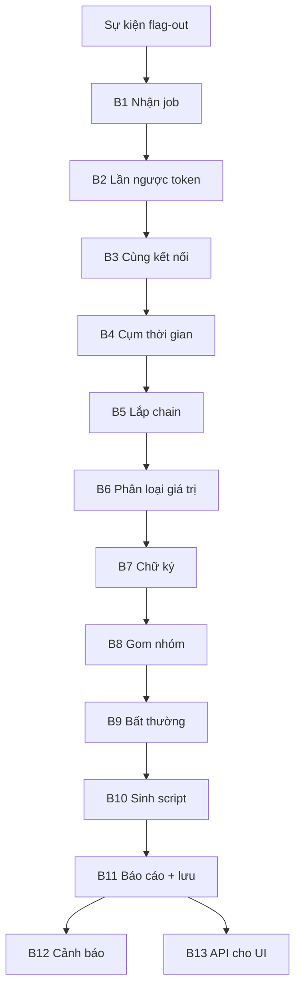

# flagtrace — Giai đoạn 2: Trace chain khi có flag-out

> **Trước khi bàn/triển khai Phase 2:** đọc [nền tích hợp ngày 2026-10-14](INTEGRATION_BASELINE.md). Spec bên dưới chưa đồng bộ với Phase 1 đã triển khai và framework hiện có; các thuật toán B1–B13 là đề xuất, chưa phải contract vận hành đã chốt.

> **Kế hoạch triển khai tiếp theo:** [PHASE2_IMPLEMENTATION_PLAN.md](PHASE2_IMPLEMENTATION_PLAN.md) cụ thể hóa hướng hồ sơ trace/timeline, chi tiết đợt đầu P2.0–P2.3 và lộ trình mở rộng. Dùng kế hoạch đó cho thứ tự công việc; các ví dụ B1–B13 bên dưới giữ vai trò tham khảo thuật toán gốc.

> Tài liệu triển khai chi tiết. Mỗi bước ghi rõ **input**, **xử lý**, **output**.
> Ví dụ xuyên suốt: service `notes`, đội 5 đánh bằng chuỗi `register → login → upload (path traversal) → đọc file`.

---

## 0. Đích đến

Khi một flow có flag-out xuất hiện, trong vòng khoảng 1 giây hệ thống phải tạo ra:

1. **Một chain**: danh sách có thứ tự các transaction thuộc exploit, mỗi transaction có lý do được nối vào và độ tin cậy.
2. **Một báo cáo phân tích** (JSON) gồm: chữ ký, nghi vấn bug, chi tiết từng bước, vai trò của từng giá trị, thống kê.
3. **Script tái hiện**: script cho từng request (giống Tulip) và script cho cả chain (giá trị động được thay bằng biến).
4. **Cảnh báo** lên Discord/Telegram nếu đây là exploit mới.
5. **Dữ liệu cho UI** qua API: danh sách nhóm exploit → chain → từng bước → request/response.

Ví dụ thứ người phân tích nhìn thấy:

```
[EXPLOIT MỚI] service notes — đội 5 — tick 42
POST /register → POST /login → POST /upload → GET /files/{id}
Nghi vấn: /upload, tham số name chứa '../'
Chain #17
```

---

## 1. Hợp đồng đầu vào (giai đoạn 1 phải cung cấp)

Giai đoạn 2 chỉ đọc DB, không đụng tới pcap. Đây là danh sách những gì giai đoạn 1 phải ghi sẵn — dùng để đối chiếu khi bàn lại giai đoạn 1.

### 1.1 Bảng `flows` (mỗi dòng là một transaction)

| Cột | Bắt buộc | Ghi chú |
|---|---|---|
| `id` | ✓ | |
| `team_id` | ✓ | NULL nếu IP lạ |
| `is_checker` | ✓ | 1 nếu từ IP checker |
| `service` | ✓ | |
| `tick` | ✓ | |
| `ts` | ✓ | thời điểm request, độ chính xác ms |
| `conn_id` | ✓ | id kết nối TCP |
| `seq_in_conn` | ✓ | thứ tự transaction trong kết nối |
| `method`, `path`, `status` | ✓ (HTTP) | |
| `req_raw`, `resp_raw` | ✓ | bytes nguyên gốc |
| `req_parsed`, `resp_parsed` | ✓ (HTTP) | JSON: headers, cookies, query, form/json body đã giải mã (gzip, chunked) |
| `flag_out` | ✓ | 1 nếu response chứa flag và nguồn không phải checker |
| `flags_found` | ✓ | danh sách flag tìm thấy (sau decoder) |

### 1.2 Bảng `tokens`

| Cột | Ghi chú |
|---|---|
| `value` | giá trị đã chuẩn hoá |
| `flow_id` | |
| `role` | `produced` (trong response) / `consumed` (trong request) |
| `location` | vị trí chính xác, xem bảng dưới |
| `parent_value` | nếu là token con tách ra từ chuỗi dài hơn |
| `team_id`, `service`, `ts` | lặp lại để truy vấn nhanh |

Quy ước `location`:

| Ví dụ | Ý nghĩa |
|---|---|
| `req.cookie.session` | cookie `session` trong request |
| `req.header.Authorization` | header |
| `req.path[1]` | đoạn thứ 2 của path (`/files/f93a1c` → `f93a1c`) |
| `req.query.id` | query string |
| `req.form.name`, `req.json.user.id` | body form / JSON (đường dẫn kiểu dot) |
| `resp.cookie.session` | Set-Cookie |
| `resp.header.Location` | header response |
| `resp.json.id` | trường trong JSON response |
| `resp.body@120:126` | offset trong body không có cấu trúc |
| `*.sub[n]` | token con thứ n tách từ giá trị cha |

### 1.3 Các bảng phụ

- `flag_ids(tick, service, team_id, value)`: flag id BTC công bố mỗi tick (nếu giải có).
- `baseline(service, method, path_template, field, stats_json)`: thống kê tham số từ traffic checker (giai đoạn 1 có thể cập nhật định kỳ từ các flow `is_checker = 1`).

### 1.4 Sự kiện kích hoạt

Giai đoạn 1 đẩy vào hàng đợi (bảng `trace_queue` hoặc queue trong bộ nhớ):

```json
{"flow_id": 105}
```

---

## 2. Tổng quan pipeline



---

## 3. Ví dụ dữ liệu đầu vào

Bảng `flows` (rút gọn), đội 5, service `notes`:

```
id   ts            conn     method path            req (tóm tắt)                                  resp (tóm tắt)
098  09:59:21.500  c-51100  GET    /               Cookie session=11aa22bb                        200 html
101  10:00:01.120  c-51234  POST   /register       user=k8x2pv&pass=q91zzr                        200 {"ok":true}
102  10:00:01.180  c-51234  POST   /login          user=k8x2pv&pass=q91zzr                        200 Set-Cookie session=ab12cd9f
103  10:00:01.200  c-51240  GET    /               Cookie session=77ee0b1a                        200 html
104  10:00:01.250  c-51234  POST   /upload         Cookie session=ab12cd9f; name=../../notes/7731.txt   200 {"id":"f93a1c"}
105  10:00:01.300  c-51234  GET    /files/f93a1c   Cookie session=ab12cd9f                        200 FLAG{a8Kd2xQ9vLm0}   ← flag_out=1
```

Bảng `tokens` (rút gọn):

```
value                  flow  role      location                ts
k8x2pv                 101   consumed  req.form.user           01.120
q91zzr                 101   consumed  req.form.pass           01.120
k8x2pv                 102   consumed  req.form.user           01.180
q91zzr                 102   consumed  req.form.pass           01.180
ab12cd9f               102   produced  resp.cookie.session     01.180
77ee0b1a               103   consumed  req.cookie.session      01.200
ab12cd9f               104   consumed  req.cookie.session      01.250
../../notes/7731.txt   104   consumed  req.form.name           01.250
7731                   104   consumed  req.form.name.sub[2]    01.250   (parent: ../../notes/7731.txt)
f93a1c                 104   produced  resp.json.id            01.250
ab12cd9f               105   consumed  req.cookie.session      01.300
f93a1c                 105   consumed  req.path[1]             01.300
```

`flag_ids`: `(42, notes, 1, "7731")` — flag id của đội mình ở tick 42.

---

## 4. Các bước chi tiết

### B1 — Nhận job

**Input:** `{"flow_id": 105}`

**Xử lý:**

1. Đọc flow F = #105.
2. Bỏ qua nếu `F.is_checker = 1` hoặc `F.team_id IS NULL` (ghi log để xem tay).
3. **Chống trùng:** nếu F đã là thành viên của một chain có sẵn (ví dụ một chain đọc 2 flag liên tiếp, flow thứ hai cũng flag-out), gắn thêm flag vào chain đó và dừng.
4. **Gom trong cửa sổ ngắn:** nếu trong `debounce` (mặc định 2s) có flag-out khác cùng đội, cùng service đang được trace, chờ job đó xong rồi kiểm tra lại bước 3.

**Output:**

```json
{"F": 105, "team_id": 5, "service": "notes", "tick": 42, "ts": "10:00:01.300",
 "flags": ["FLAG{a8Kd2xQ9vLm0}"]}
```

---

### B2 — Lần ngược theo token

**Input:** job từ B1.

**Xử lý:** BFS từ F. Với mỗi token mà flow đang xét đã *consumed*, tìm **lần xuất hiện đầu tiên** của token đó trong traffic của cùng đội (bất kể role), trước thời điểm của flow đang xét.

```python
def trace_tokens(F, cfg):
    nodes = {F.id: Node(F, reason="flagout")}
    edges = []                                   # cạnh luồng dữ liệu, dùng cho B6 và B10
    queue = [F]
    while queue and len(nodes) < cfg.max_depth:
        cur = queue.pop(0)
        for t in consumed_tokens(cur.id):        # gồm cả token con
            if is_noise(t, cfg):                 # ngắn, stoplist, max_df
                continue
            first = db.one("""
                SELECT flow_id, role, location, ts FROM tokens
                WHERE team_id = :team AND value = :v AND ts < :ts
                  AND (:same_svc = 0 OR service = :svc)
                ORDER BY ts ASC LIMIT 1
            """, team=cur.team_id, v=t.value, ts=cur.ts,
                 svc=cur.service, same_svc=cfg.same_service_only)
            if not first:
                continue                         # không có nguồn trong traffic → B6 xử lý
            edges.append(Edge(src_flow=first.flow_id, src_loc=first.location,
                              dst_flow=cur.id, dst_loc=t.location, value=t.value))
            if first.flow_id not in nodes:
                f = get_flow(first.flow_id)
                nodes[f.id] = Node(f, reason="token")
                queue.append(f)
    return nodes, edges
```

Ghi chú:

- Không giới hạn thời gian ở truy vấn này → nối được cả tài khoản tạo từ đầu giải.
- Ưu tiên token *produced* nếu cùng một giá trị vừa xuất hiện ở request vừa ở response của cùng flow.
- `max_depth` (mặc định 10) chặn trường hợp chain dài bất thường.

**Output** (với ví dụ):

```
nodes: 105 (flagout), 102 (token), 104 (token), 101 (token)

edges:
  102 resp.cookie.session  → 105 req.cookie.session   ab12cd9f
  104 resp.json.id         → 105 req.path[1]          f93a1c
  102 resp.cookie.session  → 104 req.cookie.session   ab12cd9f
  101 req.form.user        → 102 req.form.user        k8x2pv
  101 req.form.pass        → 102 req.form.pass        q91zzr
```

`7731` và `../../notes/7731.txt` không có nguồn trước #104 → không tạo cạnh, để B6 phân loại.

---

### B3 — Cùng kết nối TCP

**Input:** `nodes` từ B2.

**Xử lý:** lấy mọi transaction có `conn_id` thuộc các node hiện có. Transaction nào chưa có trong `nodes` thì thêm với `reason = same_conn`, `confidence = confirmed`.

**Output:** với ví dụ, `c-51234` chứa 101, 102, 104, 105 — đều đã có, không thêm gì.

---

### B4 — Cụm thời gian

**Input:** F, `nodes`.

**Xử lý:** lấy flow cùng đội, cùng service, đi lùi từ `F.ts`, dừng khi khoảng cách giữa hai flow liên tiếp vượt `burst_gap` hoặc vượt `burst_max_window`.

```python
def burst_before(F, gap=3.0, max_window=60.0):
    rows = db.all("""
        SELECT id, ts FROM flows
        WHERE team_id = :t AND service = :s AND is_checker = 0
          AND ts <= :ts AND ts >= :ts - :w
        ORDER BY ts DESC
    """, t=F.team_id, s=F.service, ts=F.ts, w=max_window)
    out, last = [], F.ts
    for r in rows:
        if last - r.ts > gap:
            break
        out.append(r.id); last = r.ts
    return out
```

Flow trong cụm chưa có trong `nodes` → thêm với `reason = burst`, `confidence = maybe`.

**Output:**

```
cụm: 105, 104, 103, 102, 101   (dừng ở 098 vì cách 39.6s)
thêm: 103 (burst, maybe)
```

---

### B5 — Lắp chain

**Input:** `nodes`, `edges`.

**Xử lý:** sắp các node theo `(ts, seq_in_conn)`, gán `position`.

**Output:**

```
pos  flow  method path            reason     confidence
1    101   POST   /register       token      confirmed
2    102   POST   /login          token      confirmed
3    103   GET    /               burst      maybe
4    104   POST   /upload         token      confirmed
5    105   GET    /files/f93a1c   flagout    confirmed
```

---

### B6 — Phân loại giá trị

Đây là bước biến chain từ "danh sách request" thành "exploit tái hiện được". Mỗi giá trị consumed trong các bước `confirmed` được gán một loại:

| Loại | Điều kiện | Cách xử lý trong script |
|---|---|---|
| `linked` | Có cạnh từ `resp.*` của bước trước | Bóc từ response bước nguồn theo `src_loc` |
| `session_cookie` | `linked` và vị trí là cookie | Để `requests.Session` tự giữ |
| `generated` | Xuất hiện lần đầu ở chính request này (bên đối thủ tự tạo) và được dùng lại ở bước sau | Sinh ngẫu nhiên cùng độ dài, cùng bộ ký tự |
| `target` | Không có nguồn trong traffic và khớp `flag_ids` của tick đó | Tham số `flag_id` của hàm exploit |
| `constant` | Còn lại | Giữ nguyên |
| `unknown` | Trông ngẫu nhiên, không nguồn, không khớp flag id | Giữ nguyên + cảnh báo "chưa rõ nguồn" |

**Phân biệt `constant` và `generated` tốt hơn theo thời gian:** khi đã có ≥ 2 chain cùng chữ ký, so giá trị ở cùng `location` giữa các chain. Giống nhau → `constant`; khác nhau → biến (`generated`/`target`). B8 chạy lại phân loại cho cả nhóm mỗi khi có chain mới.

Với token con: nếu `7731` (token con) là `target` thì giá trị cha `../../notes/7731.txt` trở thành template `../../notes/{flag_id}.txt`.

**Output:**

```json
[
  {"flow": 101, "location": "req.form.user", "value": "k8x2pv", "kind": "generated", "var": "user"},
  {"flow": 101, "location": "req.form.pass", "value": "q91zzr", "kind": "generated", "var": "pw"},
  {"flow": 102, "location": "req.form.user", "value": "k8x2pv", "kind": "generated", "var": "user"},
  {"flow": 102, "location": "req.form.pass", "value": "q91zzr", "kind": "generated", "var": "pw"},
  {"flow": 104, "location": "req.cookie.session", "value": "ab12cd9f", "kind": "session_cookie"},
  {"flow": 104, "location": "req.form.name", "value": "../../notes/7731.txt",
   "kind": "template", "template": "../../notes/{flag_id}.txt"},
  {"flow": 105, "location": "req.cookie.session", "value": "ab12cd9f", "kind": "session_cookie"},
  {"flow": 105, "location": "req.path[1]", "value": "f93a1c", "kind": "linked",
   "from": {"flow": 104, "location": "resp.json.id"}, "var": "file_id"}
]
```

---

### B7 — Tạo chữ ký

**Input:** các bước `confirmed` theo thứ tự.

**Xử lý (HTTP):** mỗi bước thành `METHOD /path_template`:

- Đoạn path là giá trị loại `linked`, `generated`, `target` → `{id}`.
- Đoạn path toàn số → `{n}`.
- Đoạn path hex/uuid/entropy cao (dù chưa phân loại) → `{id}`.
- Bỏ query và body.

**Xử lý (TCP thô):** mỗi bước lấy dòng lệnh đầu tiên client gửi, thay các giá trị biến thiên như trên.

Chữ ký = các bước nối bằng ` → `. Lưu thêm `sig_hash = sha1(signature)` để tra nhanh.

**Output:**

```
POST /register → POST /login → POST /upload → GET /files/{id}
sig_hash: 3f9c...e1
```

---

### B8 — Gom nhóm

**Input:** chữ ký, service.

**Xử lý:**

```sql
SELECT id FROM signatures WHERE service = :svc AND sig_hash = :h;
```

- **Chưa có** → tạo `signatures(status='new', hit_count=1, first_seen=now)`, đánh dấu `is_new = true`.
- **Đã có** → `hit_count += 1`, cập nhật `last_seen`, thêm đội vào danh sách; chạy lại phân loại B6 trên toàn nhóm (so sánh giá trị giữa các chain).

**Output:** `{"signature_id": 4, "is_new": true}`

---

### B9 — Đánh dấu bất thường

**Input:** các bước + bảng `baseline`.

**Xử lý:** với mỗi tham số của mỗi bước, so với baseline của checker cho cùng `(service, method, path_template)`:

| Kiểm tra | Ví dụ |
|---|---|
| Tham số checker không bao giờ gửi | `role=admin` |
| Bộ ký tự lệch (checker chỉ gửi `[a-z0-9_.]`) | `name` chứa `/` |
| Pattern đáng ngờ | `../`, `'`, `"`, `{{`, `${`, `<script`, `__proto__`, `;`, `|`, null byte |
| Độ dài vượt xa baseline | > p99 × 3 |
| Content-type / method khác thường | JSON gửi vào endpoint checker luôn gửi form |
| Endpoint checker chưa từng gọi | `GET /debug` |

Chưa có baseline cho endpoint → chỉ chạy kiểm tra pattern.

Mỗi điểm bất thường có điểm số; bước có tổng điểm cao nhất được đánh dấu là **nghi vấn chính**.

**Output:**

```json
{"suspects": [
  {"flow": 104, "location": "req.form.name", "value": "../../notes/7731.txt",
   "reasons": ["chứa '../'", "checker không bao giờ gửi '/'"], "score": 0.9, "primary": true}
]}
```

---

### B10 — Sinh script

**Input:** các bước, phân loại B6, `req_parsed`.

#### a) Script cho từng request (giống Tulip)

Giá trị giữ nguyên như đã bắt được. Bỏ header thư viện tự xử lý (`Host`, `Content-Length`, `Connection`, `Accept-Encoding`). Giữ đúng kiểu body (form / JSON / multipart / raw bytes).

```python
import requests
requests.post(
    "http://10.60.1.1:8080/upload",
    headers={"Cookie": "session=ab12cd9f"},
    data={"name": "../../notes/7731.txt"},
)
```

Thêm biến thể `curl` cho mỗi request. Với TCP thô: đoạn pwntools.

#### b) Script cho cả chain

Chỉ dùng các bước `confirmed`. Áp dụng phân loại B6:

```python
#!/usr/bin/env python3
# chain #17 — notes — POST /register → POST /login → POST /upload → GET /files/{id}
import re, sys, random, string, requests

FLAG_RE = re.compile(r"FLAG\{[A-Za-z0-9_]+\}")

def rnd(n, alphabet=string.ascii_lowercase + string.digits):
    return "".join(random.choices(alphabet, k=n))

def exploit(host, flag_id, port=8080):
    base = f"http://{host}:{port}"
    s = requests.Session()
    user, pw = rnd(6), rnd(6)                                   # generated

    # 1. POST /register
    s.post(f"{base}/register", data={"user": user, "pass": pw})

    # 2. POST /login  → session cookie (Session tự giữ)
    s.post(f"{base}/login", data={"user": user, "pass": pw})

    # 3. POST /upload  ⚠ nghi vấn: name chứa '../'
    r = s.post(f"{base}/upload", data={"name": f"../../notes/{flag_id}.txt"})
    file_id = r.json()["id"]                                    # linked: resp.json.id

    # 4. GET /files/{id}  → flag-out
    r = s.get(f"{base}/files/{file_id}")
    return FLAG_RE.findall(r.text)

if __name__ == "__main__":
    print(exploit(sys.argv[1], sys.argv[2]))
```

Cách bóc giá trị `linked` theo `src_loc`:

| `src_loc` | Code sinh ra |
|---|---|
| `resp.json.a.b` | `r.json()["a"]["b"]` |
| `resp.header.X` | `r.headers["X"]` |
| `resp.cookie.X` (không phải session) | `r.cookies["X"]` |
| `resp.body@i:j` | regex sinh từ ngữ cảnh 10 byte trước/sau giá trị |

Giá trị `unknown` → giữ nguyên + comment `# TODO: chưa rõ nguồn`.

**Output:** `{"per_request": {101: "...", 102: "...", ...}, "chain_script": "..."}`

#### c) (Tuỳ chọn) Replay kiểm chứng

Chạy `chain_script` vào bản service chưa vá chạy local với một flag id đã biết. Lấy được flag → gắn `reproduced = true`. Làm bất đồng bộ, không chặn pipeline.

---

### B11 — Lắp báo cáo và lưu

**Input:** kết quả B1–B10.

**Xử lý:** ghi `chains`, `chain_flows`, cột `report` (JSON) trong một transaction DB.

**Output — báo cáo cuối cùng:**

```json
{
  "chain_id": 17,
  "created": "2026-11-01T10:00:01.420+07:00",
  "service": "notes",
  "team_id": 5,
  "tick": 42,
  "flags": ["FLAG{a8Kd2xQ9vLm0}"],

  "signature": {
    "id": 4,
    "text": "POST /register → POST /login → POST /upload → GET /files/{id}",
    "is_new": true,
    "hit_count": 1,
    "teams": [5],
    "status": "new"
  },

  "suspects": [
    {"flow": 104, "location": "req.form.name", "value": "../../notes/7731.txt",
     "reasons": ["chứa '../'", "checker không bao giờ gửi '/'"], "primary": true}
  ],

  "steps": [
    {"pos": 1, "flow": 101, "method": "POST", "path": "/register", "status": 200,
     "reason": "token", "confidence": "confirmed",
     "values": [{"location": "req.form.user", "value": "k8x2pv", "kind": "generated"},
                {"location": "req.form.pass", "value": "q91zzr", "kind": "generated"}]},
    {"pos": 2, "flow": 102, "method": "POST", "path": "/login", "status": 200,
     "reason": "token", "confidence": "confirmed",
     "produces": [{"location": "resp.cookie.session", "value": "ab12cd9f"}]},
    {"pos": 3, "flow": 103, "method": "GET", "path": "/", "status": 200,
     "reason": "burst", "confidence": "maybe"},
    {"pos": 4, "flow": 104, "method": "POST", "path": "/upload", "status": 200,
     "reason": "token", "confidence": "confirmed", "suspect": true,
     "produces": [{"location": "resp.json.id", "value": "f93a1c"}]},
    {"pos": 5, "flow": 105, "method": "GET", "path": "/files/f93a1c", "status": 200,
     "reason": "flagout", "confidence": "confirmed"}
  ],

  "dataflow": [
    {"value": "k8x2pv",   "from": "101 req.form.user",       "to": ["102 req.form.user"]},
    {"value": "ab12cd9f", "from": "102 resp.cookie.session", "to": ["104 req.cookie.session", "105 req.cookie.session"]},
    {"value": "f93a1c",   "from": "104 resp.json.id",        "to": ["105 req.path[1]"]}
  ],

  "scripts": {
    "per_request": {"101": "...", "102": "...", "104": "...", "105": "..."},
    "chain": "#!/usr/bin/env python3 ...",
    "reproduced": null
  },

  "warnings": []
}
```

Request/response đầy đủ **không** nằm trong báo cáo — UI lấy qua `GET /flows/{id}`.

---

### B12 — Cảnh báo

**Input:** báo cáo.

**Xử lý:**

- `is_new = true` → gửi ngay.
- Chữ ký cũ nhưng **đội mới** dùng → gửi bản ngắn ("đội 9 cũng dùng exploit #4").
- Chữ ký cũ, đội cũ → không gửi.
- Chữ ký đang ở `status = patched` mà vẫn có flag-out → gửi cảnh báo mức cao ("patch không chặn được").

**Output:**

```
[EXPLOIT MỚI] service notes — đội 5 — tick 42
POST /register → POST /login → POST /upload → GET /files/{id}
Nghi vấn: /upload, tham số name chứa '../'
Chain #17
```

---

### B13 — API cho UI

| Endpoint | Trả về |
|---|---|
| `GET /signatures?service=&status=` | danh sách nhóm exploit |
| `GET /signatures/{id}` | chi tiết nhóm + danh sách chain |
| `GET /chains/{id}` | `report` của chain |
| `GET /flows/{id}` | request/response (thô + đã giải mã), vị trí token để tô màu |
| `GET /flows/{id}/script?fmt=python\|curl\|pwntools` | script cho một request |
| `GET /chains/{id}/script` | script cho cả chain |
| `PATCH /signatures/{id}` | đổi trạng thái `new → analyzing → patched` |
| `WS /events` | đẩy chain/chữ ký mới theo thời gian thực |

Hành vi UI kỳ vọng: tab "Flag-out" liệt kê nhóm exploit → bấm vào nhóm thấy các chain → bấm vào chain thấy các bước theo thứ tự (bước `maybe` hiển thị mờ, bước nghi vấn tô đỏ) → bấm vào bước thấy request/response, cùng token tô cùng màu, mỗi bước có nút copy script, chain có nút copy script cả chuỗi.

---

## 5. Tham số cấu hình

```yaml
trace:
  max_depth: 10
  same_service_only: true
  burst_gap: 3.0          # giây
  burst_max_window: 60    # giây
  debounce: 2.0           # giây, gom flag-out liên tiếp
token:
  min_len: 6
  max_df: 0.3
  stoplist: ["true", "false", "null", "admin", "user", "login"]
  split_chars: "/._-=&"
anomaly:
  length_factor: 3
  patterns: ["../", "'", "\"", "{{", "${", "<script", "__proto__", ";", "|", "%00"]
script:
  drop_headers: ["Host", "Content-Length", "Connection", "Accept-Encoding"]
replay:
  enabled: false
  target: "http://127.0.0.1:18080"
```

---

## 6. Trường hợp biên

| Tình huống | Xử lý |
|---|---|
| Đối thủ dùng tài khoản tạo sẵn từ lâu | B2 không giới hạn thời gian → vẫn nối được |
| Nhiều exploit song song cùng service | B2 tách theo token; flow chỉ thuộc cụm thời gian → `maybe` |
| Chain chỉ có 1 bước (đọc flag thẳng, ví dụ SQLi) | Chain hợp lệ một bước; chữ ký là một endpoint |
| Không có token nào (service không session) | Chỉ còn B3 + B4; mọi bước ngoài F là `maybe`, báo cáo ghi `warnings: ["chain chỉ dựa trên thời gian"]` |
| Một response chứa nhiều flag | Một chain, `flags` là danh sách |
| Hai flag-out trong cùng chain | B1 bước 3 gắn vào chain có sẵn |
| Request rác chèn giữa chuỗi | Không có token chung → tối đa `maybe` |
| Exfil qua hai tài khoản | Nối được nếu hai bước chung giá trị (đường dẫn, id) |
| Giá trị target không khớp flag id | Loại `unknown`, script có TODO |
| Chain dài bất thường (> max_depth) | Cắt, ghi warning |

---

## 7. Hiệu năng

- Mục tiêu: một trace < 1 giây.
- Truy vấn B2 dựa vào index `tokens(team_id, value, ts)`; B4 dựa vào `flows(team_id, service, ts)`.
- Trace chạy trong worker riêng, đọc DB ở chế độ WAL, không chặn ingest.
- Phân loại lại cả nhóm (B8) chỉ đụng tới các chain cùng chữ ký, có thể giới hạn ở N chain gần nhất.

---

## 8. Kế hoạch kiểm thử

1. **Dữ liệu giả lập:** viết một service `notes` nhỏ có đúng bug path traversal, một checker giả (putflag/getflag), và script tấn công. Chạy vài tick, capture pcap → làm bộ dữ liệu chuẩn.
2. **Unit test từng bước** với bảng `flows`/`tokens` dựng tay như mục 3: kiểm tra output B2–B9 khớp với tài liệu này.
3. **Kịch bản biên:** tài khoản tạo sẵn, hai exploit song song, request rác, service không session.
4. **End-to-end:** pcap → báo cáo → script chain chạy lại lấy được flag trên service giả.

---

## 9. Những gì cần chốt lại với giai đoạn 1

- [ ] Parser HTTP sinh `req_parsed`/`resp_parsed` theo đúng cấu trúc (headers, cookies, query, form, json, multipart).
- [ ] Token extractor ghi `location` theo quy ước mục 1.2, kể cả token con và `parent_value`.
- [ ] `seq_in_conn` cho thứ tự transaction trong kết nối keep-alive.
- [ ] Nguồn `flag_ids` (API của BTC? định dạng?).
- [ ] Ai cập nhật `baseline` và bao lâu một lần.
- [ ] Cơ chế đẩy sự kiện flag-out (bảng queue hay queue trong bộ nhớ).
- [ ] Parser cho service TCP thô: tách transaction và token thế nào.
